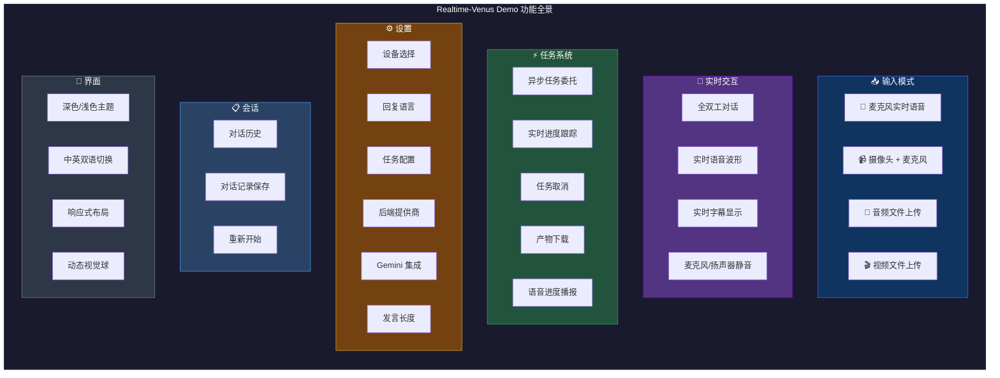
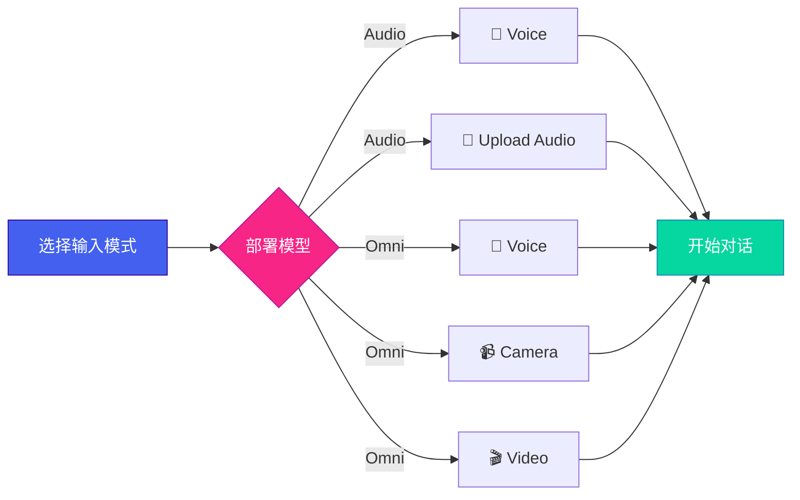
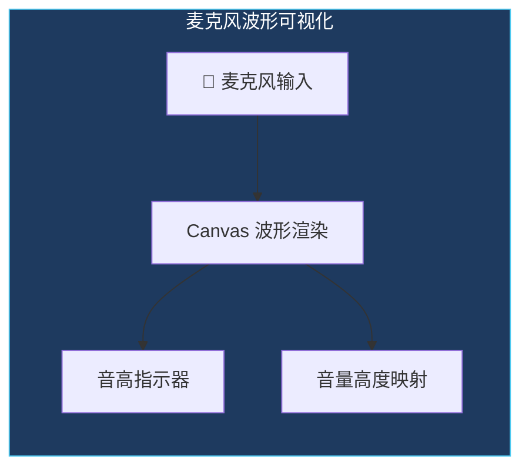
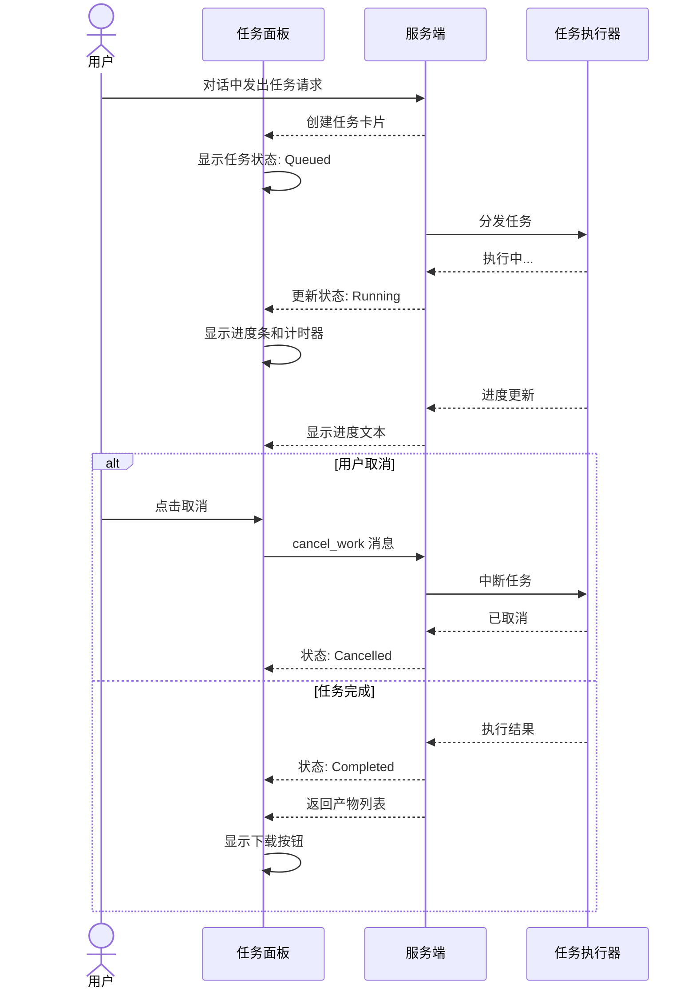
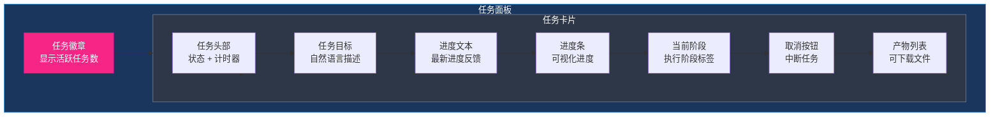
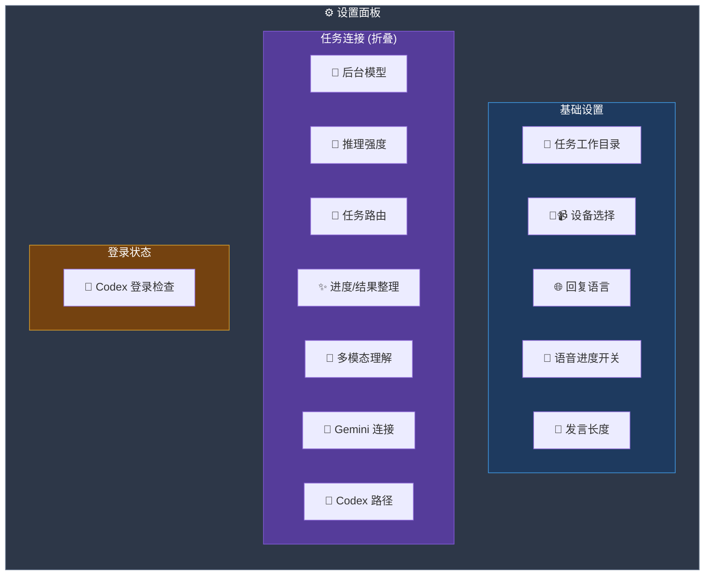
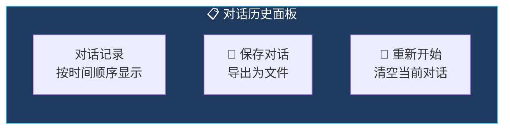
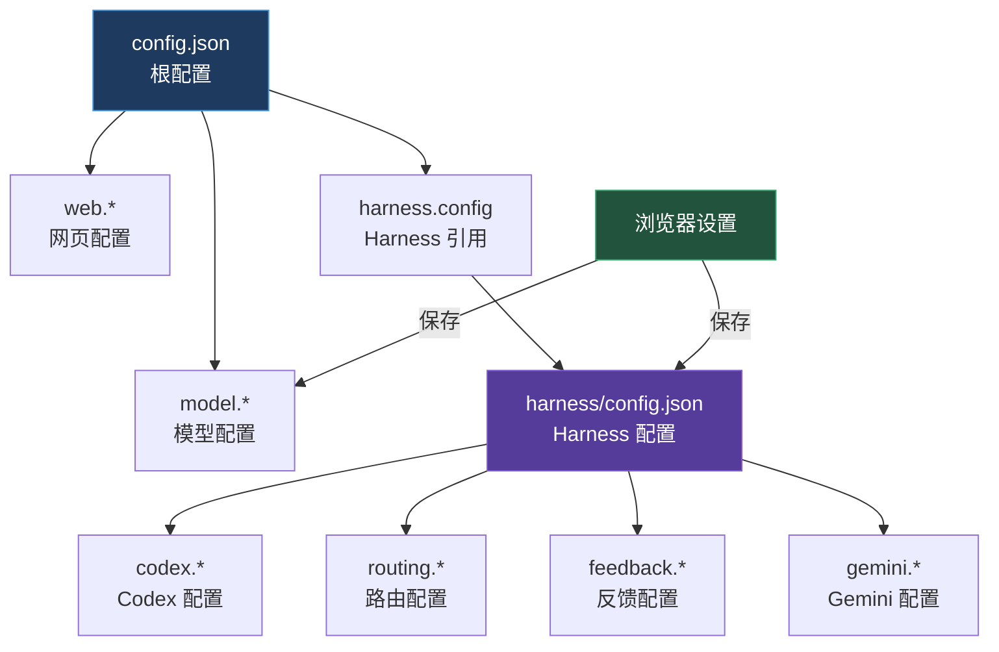

# Realtime-Venus Demo 功能手册

> **版本**: 2026-09-21  
> **适用对象**: 使用 Realtime-Venus 浏览器 Demo 的终端用户和部署者

---

## 目录

- [1. 功能总览](#1-功能总览)
- [2. 输入模式](#2-输入模式)
- [3. 实时交互功能](#3-实时交互功能)
- [4. 任务系统](#4-任务系统)
- [5. 设置面板](#5-设置面板)
- [6. 会话管理](#6-会话管理)
- [7. UI 界面功能](#7-ui-界面功能)
- [8. API 接口](#8-api-接口)
- [9. 服务管理命令](#9-服务管理命令)
- [10. 配置参考](#10-配置参考)

---

## 1. 功能总览



---

## 2. 输入模式

Demo 支持四种输入模式，根据部署时选择的模型（Audio 或 Omni）自动适配。

### 2.1 模式对照表

| 模式 | 图标 | 输入方式 | 适用模型 | 说明 |
|------|------|----------|----------|------|
| **🎤 Voice（语音）** | 麦克风 | 实时麦克风 | Audio / Omni | 纯语音对话，通过本地扬声器收听回复 |
| **📹 Camera（摄像头）** | 摄像头 | 摄像头 + 麦克风 | 仅 Omni | 音视频同时采集，网页显示实时预览 |
| **🎬 Video（视频）** | 上传 | 本地视频文件 | 仅 Omni | 上传 MP4/MOV/WebM，最大 200 MB |
| **🎵 Upload Audio（上传音频）** | 上传 | 本地音频文件 | 仅 Audio | 上传 WAV/MP3/M4A/FLAC/OGG，最大 200 MB |

### 2.2 模式切换



### 2.3 文件上传

- **拖拽上传**：将文件拖入上传区域
- **点击选择**：点击上传区域选择文件
- **格式支持**：
  - 视频：MP4、MOV、WebM
  - 音频：WAV、MP3、M4A、FLAC、OGG
- **大小限制**：最大 200 MB
- **上传进度**：显示上传进度条

---

## 3. 实时交互功能

### 3.1 全双工对话

- **边说边听**：模型在说话时继续处理用户输入
- **智能打断**：能区分附和（嗯、哦）、背景人声和真正的打断
- **主动回应**：Omni 模型可根据场景变化主动发起回应

### 3.2 实时语音波形



- **实时显示**：Canvas 绘制的动态波形
- **音量映射**：波形高度随音量变化
- **音高指示**：波浪间距表示音高
- **静音按钮**：一键静音麦克风

### 3.3 字幕系统

- **实时字幕**：模型回复实时显示为文字
- **说话人标识**：显示 "VENUS" 标识
- **语音动画**：说话时显示声波动画

### 3.4 媒体预览

| 功能 | 说明 |
|------|------|
| 视频预览 | 摄像头画面实时预览 |
| 替换视频 | 对话中可更换视频源 |
| 音频预览 | 上传音频可预览播放 |
| 视角标签 | 显示 "Your perspective" 标签 |

### 3.5 控制按钮

| 按钮 | 功能 | 显示条件 |
|------|------|----------|
| ▶️ **Start** | 开始对话 | 空闲状态 |
| ⏹️ **End** | 结束对话 | 对话中 |
| 🎤 **Mute Mic** | 静音/取消静音麦克风 | 对话中 |
| 🔊 **Mute Speaker** | 静音/取消静音扬声器 | 对话中 |

---

## 4. 任务系统

任务系统是 Demo 的核心功能之一，支持在对话中异步执行后台任务。

### 4.1 任务流程



### 4.2 任务状态

| 状态 | 图标 | 说明 |
|------|------|------|
| **Queued** | 🔄 | 任务已提交，等待执行 |
| **Routing** | 🔀 | Auto 模式下正在选择能力 |
| **Running** | ⚙️ | 任务正在执行 |
| **Returning** | 📤 | 正在准备语音回复 |
| **Delivered** | ✅ | 结果已语音播报 |
| **Failed** | ❌ | 执行失败 |
| **Cancelled** | 🚫 | 用户取消 |
| **Cancelling** | ⏳ | 正在取消中 |

### 4.3 任务面板功能



### 4.4 任务卡片详情

| 元素 | 说明 |
|------|------|
| **任务状态标签** | 当前状态的文本描述 |
| **轨道动画** | 运行中任务的动态轨道效果 |
| **完成图标** | 已完成任务显示 ✓ |
| **任务目标** | 任务的自然语言描述 |
| **进度文本** | 显示错误信息 > 结果文本 > 进度文本 > 默认提示 |
| **计时器** | MM:SS 格式显示任务耗时 |
| **取消按钮** | 运行中任务可点击取消 |
| **产物下载** | 每个产物显示为可下载按钮 |

### 4.5 语音进度播报

- **默认关闭**：需要用户在设置中手动开启
- **开启方式**：设置 → 你的对话 → 自动播报任务进度 → 开启
- **播报规则**：有新进展时用一句话播报
- **不影响**：关闭不影响任务执行、完成结果或主动询问进度

---

## 5. 设置面板

### 5.1 设置面板结构



### 5.2 基础设置

| 设置项 | 类型 | 默认值 | 说明 |
|--------|------|--------|------|
| **任务工作目录** | 文本输入 | 空（必填） | 服务器上的任务文件目录 |
| **麦克风** | 下拉选择 | 系统默认 | 选择麦克风设备 |
| **摄像头** | 下拉选择 | 系统默认 | 选择摄像头设备 |
| **回复语言** | 下拉选择 | 中文 | 中文 / English |
| **语音进度播报** | 下拉选择 | 关闭 | 关闭 / 开启（需同意） |
| **发言长度** | 数字输入 | 0.8 | 范围 0.1–5，<1 倾向短回复 |

### 5.3 任务连接设置

#### 基础配置

| 设置项 | 选项 | 说明 |
|--------|------|------|
| **后台模型** | 文本输入 | 留空使用任务模型或服务器默认 |
| **推理强度** | Minimal / Low / Medium / High / Extra High | 仅 Codex 有效 |

#### 任务路由

| 设置项 | 选项 | 说明 |
|--------|------|------|
| **任务模式** | General（默认）/ Auto | General 直接执行；Auto 自动选择能力 |
| **路由提供商** | Codex / Gemini | Auto 模式下使用 |
| **路由模型** | 文本输入 | 留空继承规则 |
| **路由推理强度** | Minimal ~ Extra High | 建议 Low |
| **路由超时** | 1–180 秒 | 默认 30 秒 |

#### 进度/结果整理（Polish）

| 设置项 | 选项 | 说明 |
|--------|------|------|
| **提供商** | Codex / Gemini | 独立选择 |
| **摘要模型** | 文本输入 | 留空继承 |
| **推理强度** | Minimal ~ Extra High | - |

#### 多模态理解

| 设置项 | 选项 | 说明 |
|--------|------|------|
| **提供商** | Codex / Gemini | Auto 路由到多模态时使用 |
| **多模态模型** | 文本输入 | 留空继承 |
| **推理强度** | Minimal ~ Extra High | - |

> ⚠️ **注意**：Codex 不支持音频理解，需音频理解时选择 Gemini

#### Gemini 连接

| 设置项 | 说明 |
|--------|------|
| **默认模型** | 如 `gemini-flash-latest` |
| **API Key** | 密码输入框，留空保留已保存的密钥 |

> 🔒 密钥以 `0600` 权限保存在服务器，不会返回浏览器

### 5.4 Codex 登录检查

| 状态 | 显示文本 |
|------|----------|
| 已登录 | "Logged in · ready for background tasks" |
| 未登录 | "Not logged in · log in on the server..." |
| 未找到 | "Codex was not found · check its executable path" |
| 超时 | "Login check timed out · check Codex on the server" |
| 错误 | "Login could not be verified · check Codex..." |

- **重新检查**：点击 "Recheck login" 按钮
- **阻塞条件**：未登录或检查失败时无法开始新对话

---

## 6. 会话管理

### 6.1 对话历史



| 功能 | 说明 |
|------|------|
| **对话历史** | 显示 Venus 的所有回复 |
| **保存对话** | 导出对话记录为文件 |
| **重新开始** | 清空当前对话，开始新会话 |

### 6.2 会话限制

- **单会话**：同时只支持一个活跃对话
- **设备验证**：开始对话前验证 Codex 登录
- **设置验证**：未完成设置时提示完成

---

## 7. UI 界面功能

### 7.1 主题切换

| 主题 | 图标 | 说明 |
|------|------|------|
| **深色主题** | 🌙 | 默认主题，暗色背景 |
| **浅色主题** | ☀️ | 明亮背景 |

- 点击右上角主题按钮切换
- 自动记住用户选择

### 7.2 语言切换

| 语言 | 按钮 | 说明 |
|------|------|------|
| **English** | 中 | 切换到中文 |
| **中文** | EN | 切换到英文 |

- 支持完整的中英文双语界面
- 对话回复语言在设置中单独配置

### 7.3 动态视觉球

- **Presence Canvas**：动态渲染的视觉效果
- **状态指示**：根据系统状态变化
- **标题文字**：
  - 空闲：*"A little presence. A world of possibilities."*
  - 对话中：根据状态动态更新

### 7.4 连接状态

| 状态 | 显示 |
|------|------|
| 就绪 | "Ready when you are" + 绿点 |
| 忙碌 | "Another conversation is using Venus" |
| 配置中 | "Set up your connection first" |

### 7.5 响应式设计

- 适配桌面和移动端
- 安全区域适配（viewport-fit=cover）
- 触摸友好的控件尺寸

---

## 8. API 接口

### 8.1 HTTP 接口

| 方法 | 路径 | 说明 |
|------|------|------|
| `GET` | `/` | 返回主页面 |
| `GET` | `/health` | 健康检查 |
| `GET` | `/api/config` | 获取当前配置 |
| `POST` | `/api/config` | 保存配置（需 Token） |
| `GET` | `/api/status` | 获取服务状态 |
| `POST` | `/api/sessions/{sid}/video` | 上传视频文件 |
| `POST` | `/api/sessions/{sid}/audio` | 上传音频文件 |
| `GET` | `/api/sessions/{sid}/works/{work_id}/artifacts/{index}` | 下载任务产物 |

### 8.2 WebSocket 接口

**连接地址**：`ws://host:8032/ws?mode={mode}&source={source}`

| 参数 | 值 | 说明 |
|------|-----|------|
| `mode` | `audio` / `video` | 输入模式 |
| `source` | `live` / `audio_file` / `video` | 输入来源 |

### 8.3 WebSocket 消息

#### 客户端 → 服务端

| 消息类型 | 数据 | 说明 |
|----------|------|------|
| `audio` | `{data: base64}` | 发送音频块 (PCM16, ≤128KB) |
| `video_frame` | `{data: base64}` | 发送视频帧 (JPEG, ≤190KB) |
| `cancel_work` | `{work_id: string}` | 取消任务 |
| `ack_playback` | `{utterance_id, chunk_seq}` | 确认播放完成 |

#### 服务端 → 客户端

| 消息类型 | 数据 | 说明 |
|----------|------|------|
| `playback` | `{utterance_id, chunk_seq, text, data, format, sample_rate, channels, silent}` | 语音合成数据 |
| `works` | `[{work_id, state, phase, objective, progress_text, ...}]` | 任务状态更新 |
| `fatal_error` | `{code, error}` | 致命错误 |
| `transcript` | `{text, speaker}` | 对话文本 |

---

## 9. 服务管理命令

```bash
# 启动服务
bash start.sh --config config.json

# 后台启动（服务就绪后返回）
bash start.sh --config config.json --detach

# 预检查（不启动服务）
bash start.sh --config config.json --check --no-login

# 查看状态
bash start.sh --status

# 停止服务
bash start.sh --stop
```

### 9.1 命令选项

| 选项 | 说明 |
|------|------|
| `--config <path>` | 指定配置文件 |
| `--detach` | 后台启动 |
| `--check` | 仅预检查 |
| `--no-login` | 不发起登录流程 |
| `--status` | 显示服务状态 |
| `--stop` | 停止服务 |

### 9.2 日志文件

| 路径 | 内容 |
|------|------|
| `runtime/logs/model.log` | 模型加载与推理 |
| `runtime/logs/web.log` | 网页连接、上传与会话错误 |
| `runtime/logs/stack.log` | 后台启动与进程管理 |

---

## 10. 配置参考

### 10.1 配置文件关系



### 10.2 Demo 配置 (config.json)

```json
{
  "model": {
    "type": "video",           // "audio" | "video" | "omni"
    "path": "Realtime-Venus-Omni",
    "reference_audio": "",     // 参考音色文件
    "port": 8031,              // 模型服务端口
    "memory_minutes": 40,      // 视频记忆时长
    "length_penalty": 0.8,     // 发言长度 (0.1-5)
    "timeout_s": 180           // 请求超时
  },
  "harness": {
    "config": "harness/config.json"
  },
  "web": {
    "host": "127.0.0.1",
    "port": 8032
  },
  "startup_timeout": 600
}
```

### 10.3 环境变量

| 变量 | 说明 |
|------|------|
| `VENUS_MODEL_TYPE` | 模型类型 |
| `MODEL_PATH` | 模型路径 |
| `AUDIO_MODEL_PATH` | Audio 模型路径 |
| `OMNI_MODEL_PATH` | Omni 模型路径 |
| `REF_AUDIO` | 参考音频 |
| `VENUS_MODEL_PORT` | 模型端口 |
| `VENUS_MEMORY_MINUTES` | 记忆时长 |
| `VENUS_WEB_HOST` | Web 主机 |
| `VENUS_WEB_PORT` | Web 端口 |
| `VENUS_STARTUP_TIMEOUT` | 启动超时 |
| `HARNESS_CONFIG` | Harness 配置路径 |
| `GEMINI_API_KEY` | Gemini API Key |
| `GOOGLE_API_KEY` | Google API Key (备选) |

**优先级**：CLI > 环境变量 > 配置文件 > 默认值

---

## 附录：功能清单速查

| # | 功能 | 类别 | 说明 |
|---|------|------|------|
| 1 | 麦克风实时语音 | 输入 | 全双工语音对话 |
| 2 | 摄像头视频交互 | 输入 | Omni 专属 |
| 3 | 视频文件上传 | 输入 | 最大 200MB |
| 4 | 音频文件上传 | 输入 | 最大 200MB |
| 5 | 全双工对话 | 交互 | 边说边听 |
| 6 | 实时语音波形 | 交互 | Canvas 可视化 |
| 7 | 实时字幕 | 交互 | 模型回复文字 |
| 8 | 麦克风静音 | 交互 | 一键静音 |
| 9 | 扬声器静音 | 交互 | 一键静音 |
| 10 | 异步任务委托 | 任务 | 对话中派发任务 |
| 11 | 任务进度跟踪 | 任务 | 实时更新状态 |
| 12 | 任务取消 | 任务 | 中断执行中任务 |
| 13 | 产物下载 | 任务 | 下载生成的文件 |
| 14 | 语音进度播报 | 任务 | 可选自动播报 |
| 15 | 设备选择 | 设置 | 选择麦克风和摄像头 |
| 16 | 回复语言 | 设置 | 中文/English |
| 17 | 发言长度控制 | 设置 | 0.1-5 范围 |
| 18 | 任务模式选择 | 设置 | General/Auto |
| 19 | 后端提供商 | 设置 | Codex/Gemini |
| 20 | Gemini 集成 | 设置 | 可选多角色使用 |
| 21 | Codex 登录检查 | 设置 | 自动验证 |
| 22 | 对话历史 | 会话 | 查看回复记录 |
| 23 | 对话保存 | 会话 | 导出对话文件 |
| 24 | 重新开始 | 会话 | 清空当前对话 |
| 25 | 深色/浅色主题 | UI | 一键切换 |
| 26 | 中英双语 | UI | 界面语言切换 |
| 27 | 动态视觉球 | UI | 状态可视化 |
| 28 | SSH 隧道访问 | 部署 | localhost 访问 |

---

*本手册基于 Realtime-Venus Demo 源码分析生成。*
