# Realtime-Venus 项目分析报告

> **分析日期**: 2026-11-14  
> **项目地址**: https://github.com/inclusionAI/Realtime-Venus  
> **论文**: [arXiv:2609.13814](https://arxiv.org/pdf/2609.13814)  
> **许可协议**: Apache License 2.0

---

## 1. 项目概述

**Realtime-Venus** 是由 **蚂蚁集团 Venus Team** 与 **清华大学** 联合研发的 **全双工实时交互系统**，支持异步任务委托。核心理念是：**实时看、听、说，同时让后台任务与对话并行进行**。

用户可以与助手实时对话，同时委托它执行后台任务；任务完成后，结果自动回到同一段对话中，由模型用语音播报。

### 1.1 核心能力

| 能力 | 说明 |
|------|------|
| **持续视听交互** | Omni 模型持续接收摄像头和麦克风输入，根据场景变化主动发起回应 |
| **全双工对话** | 模型在说话时继续处理用户输入，能区分附和、背景人声和真正的打断 |
| **异步任务委托** | 模型将自然语言任务交给 Harness 执行，实时对话继续进行 |
| **原对话交付结果** | Harness 准备回复内容，前端模型决定发言时机并生成原生语音 |

---

## 2. 项目架构

### 2.1 三大核心组件

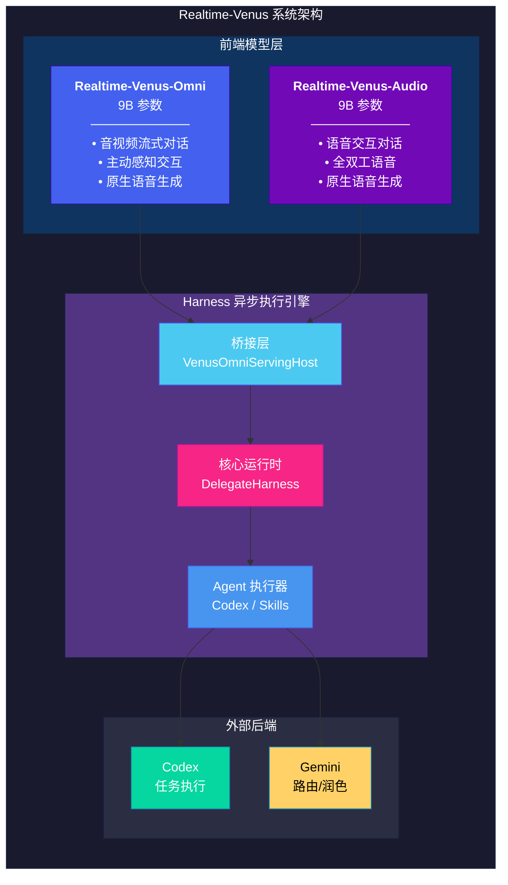

| 组件 | 职责 | 模型规模 |
|------|------|----------|
| **Realtime-Venus-Omni** | 面向流式音视频的对话模型，支持持续感知、主动交互与原生语音生成 | 9B 参数 |
| **Realtime-Venus-Audio** | 单独训练的语音对话模型，支持音频理解、全双工交互与原生语音生成 | 9B 参数 |
| **Realtime-Venus-Harness** | 两类模型共用的异步执行框架，负责接收委托、推进后台任务，并将结果送回原会话 | 独立包 |

### 2.2 双循环架构

系统采用 **双循环（Two Loops）** 设计：

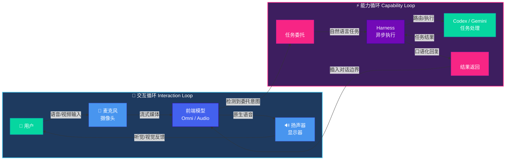

- **交互循环（Interaction Loop）**：前端模型处理流式媒体和语音，实时与用户交互
- **能力循环（Capability Loop）**：Harness 异步执行 `<delegate>...</delegate>` 请求，通过 `<backend>...</backend>` 标记将结果返回给前端模型进行语音播报

---

## 3. 目录结构详解

```text
Realtime-Venus/
├── harness/                    # 异步任务执行引擎（独立可发布包）
│   ├── core/                   # 核心运行时
│   │   ├── harness.py          # DelegateHarness - 公共异步门面
│   │   ├── backend.py          # DelegateBackend 协议定义
│   │   ├── session.py          # 双工协议会话管理
│   │   ├── scheduler.py        # 任务调度器
│   │   ├── config.py           # Harness 配置
│   │   ├── models.py           # 数据模型（AudioChunk, VideoFrame 等）
│   │   ├── buffers.py          # 上下文缓冲区
│   │   ├── delivery.py         # 结果交付逻辑
│   │   ├── result_manager.py   # 结果管理
│   │   ├── delegate_parser.py  # <delegate> 协议解析
│   │   ├── speech.py           # 语音处理
│   │   ├── media.py            # 媒体处理
│   │   ├── workspace.py        # 工作空间管理
│   │   └── ...
│   ├── bridge/                 # 模型集成桥接层
│   │   ├── host.py             # VenusOmniServingHost
│   │   ├── serving.py          # 模型服务端口
│   │   ├── runtime.py          # 运行时桥接
│   │   └── ...
│   ├── agents/                 # Agent 执行器
│   │   ├── codex.py            # Codex Agent 提供者
│   │   ├── app_server.py       # 应用服务器连接
│   │   ├── contracts.py        # Agent 合约
│   │   ├── vision.py           # 视觉处理
│   │   ├── media.py            # 媒体处理
│   │   └── ...
│   ├── llm/                    # LLM 后端
│   │   ├── backends.py         # CodexPlannerBackend
│   │   ├── delegate.py         # CodexDirectAndPolish
│   │   ├── gemini.py           # Gemini 后端
│   │   ├── planner.py          # PlannerClient 路由
│   │   └── ...
│   ├── jobs/                   # 任务生命周期管理
│   │   ├── manager.py          # 任务管理器
│   │   ├── models.py           # 任务状态模型
│   │   ├── feedback.py         # 反馈处理
│   │   ├── progress.py         # 进度跟踪
│   │   └── ...
│   ├── config.py               # 配置加载
│   ├── settings.py             # 设置管理
│   ├── factory.py              # Harness 工厂
│   ├── backends.py             # 后端选择
│   ├── skills.py               # 技能注册
│   └── prompts.py              # 提示词
│
├── frontend/                   # 独立推理示例
│   ├── Realtime-Venus-Omni/    # 视听模型推理
│   │   ├── offline_chat.py         # 离线视频对话
│   │   ├── offline_memory_chat.py  # 带长期记忆的离线对话
│   │   ├── duplex_chat.py          # 全双工视频交互（文本提问）
│   │   ├── duplex_speech_in_chat.py # 全双工视频交互（语音提问）
│   │   └── duplex_memory_chat.py   # 带长期记忆的全双工对话
│   └── Realtime-Venus-Audio/   # 音频模型推理
│       ├── audio_offline_chat.py    # 离线音频理解
│       ├── audio_duplex_chat.py     # 全双工音频交互
│       └── case/                    # 示例音频素材
│
├── demos/                      # 浏览器在线演示
│   ├── server/                 # Web 服务
│   │   ├── app.py              # FastAPI 应用主入口
│   │   ├── session.py          # WebAgentSession 会话管理
│   │   ├── resources.py        # 资源管理
│   │   ├── configuration.py    # Web 配置管理
│   │   ├── media.py            # 媒体处理
│   │   ├── backends.py         # 后端配置
│   │   └── cli.py              # 命令行接口
│   ├── model/                  # 模型服务
│   │   ├── server.py           # 模型 HTTP API (端口 8031)
│   │   ├── adapter.py          # 模型适配器
│   │   ├── client.py           # 模型客户端
│   │   ├── decoding.py         # 解码参数
│   │   └── wire.py             # 通信协议
│   ├── launcher/               # 启动器
│   │   ├── cli.py              # CLI 入口
│   │   ├── supervisor.py       # 进程管理
│   │   ├── config.py           # 配置校验
│   │   └── options.py          # 启动选项
│   ├── static/                 # 前端静态资源
│   │   ├── index.html          # 主页面
│   │   ├── app.js              # 前端逻辑
│   │   └── fonts/              # 字体文件
│   ├── settings.py             # 设置持久化
│   ├── deployment.py           # 部署配置
│   ├── install.py              # 安装脚本
│   ├── variants.py             # 模型变体
│   └── requirements.txt        # Demo 依赖
│
├── tests/                      # 测试套件
│   ├── test_download_models.py
│   ├── test_gemini_provider.py
│   ├── test_media_recovery.py
│   ├── test_model_modes.py
│   ├── test_web_configuration.py
│   └── ...
│
├── assets/                     # 资源文件
│   ├── paper-*.svg             # 论文图片
│   ├── experience-*.png        # Demo 截图
│   └── technical_report.pdf    # 技术报告
│
├── config.json                 # 根配置（前端模型 + Web 服务）
├── download_models.py          # 统一模型下载器
├── pyproject.toml              # Harness 包配置
├── requirements.txt            # 共享依赖入口
├── install.sh                  # 安装脚本
├── start.sh                    # 启动脚本
├── README.md                   # 英文说明
├── README_ZH.md                # 中文说明
└── LICENSE                     # Apache 2.0
```

---

## 4. 技术栈

### 4.1 后端技术

| 技术 | 版本/用途 |
|------|-----------|
| **Python** | >= 3.11（Harness）/ 3.10（推理示例） |
| **PyTorch** | 2.4.0（模型推理） |
| **Transformers** | 4.51.3（Hugging Face 模型加载） |
| **FastAPI** | >= 0.115（Web 服务框架） |
| **Uvicorn** | >= 0.30（ASGI 服务器） |
| **httpx** | >= 0.28（HTTP 客户端，含 Gemini 支持） |
| **FFmpeg/av** | >= 12（音视频处理） |
| **Pillow** | >= 10.4（图像处理） |

### 4.2 模型相关

| 组件 | 说明 |
|------|------|
| **模型规模** | 9B 参数（Omni 和 Audio 各自） |
| **精度** | BF16（推理） |
| **注意力机制** | SDPA（Scaled Dot-Product Attention） |
| **语音解码** | minicpmo-utils[tts]==1.0.6 |
| **语音合成** | 原生 TTS 模块（flow.yaml/hift.pt/campplus.onnx） |

### 4.3 外部集成

| 服务 | 用途 |
|------|------|
| **Codex** | 默认任务执行后端（General 模式） |
| **Gemini** | 可选的 Routing/Polish/Multimodal 后端 |
| **Hugging Face Hub** | 模型下载 |
| **ModelScope** | 国内镜像下载 |

---

## 5. 核心模块详解

### 5.1 Harness 异步执行引擎

Harness 是系统的核心创新，实现了 **对话中的异步任务委托**。

#### 工作流程

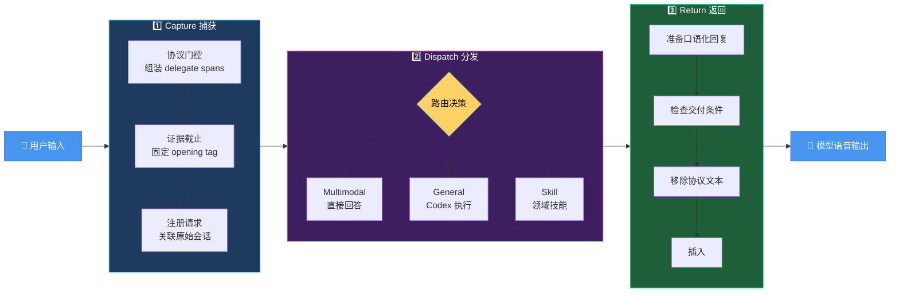

#### 任务生命周期

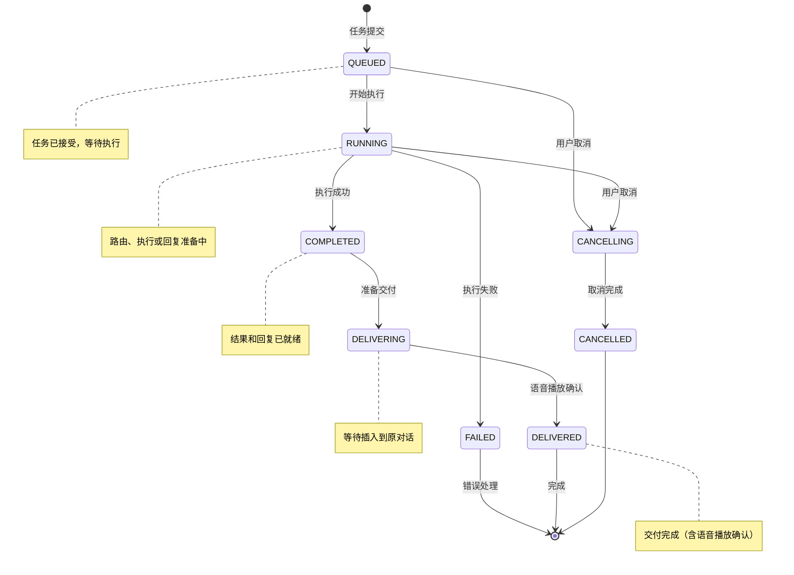

| 状态 | 含义 |
|------|------|
| `QUEUED` | 任务已接受，等待执行 |
| `RUNNING` | 路由、执行或回复准备中 |
| `COMPLETED` | 结果和回复已就绪 |
| `DELIVERING` | 等待插入到原对话 |
| `DELIVERED` | 交付完成（含语音播放确认） |

#### 执行路径

| 路径 | 用途 | 实现 |
|------|------|------|
| **Multimodal / Direct** | 使用现有音视频证据直接回答 | `llm/delegate.py` |
| **General** | 需要工具或多步执行的复杂任务 | `agents/`, `jobs/` |
| **Skill** | 执行已注册的领域技能 | `skills.py` |

#### 核心接口

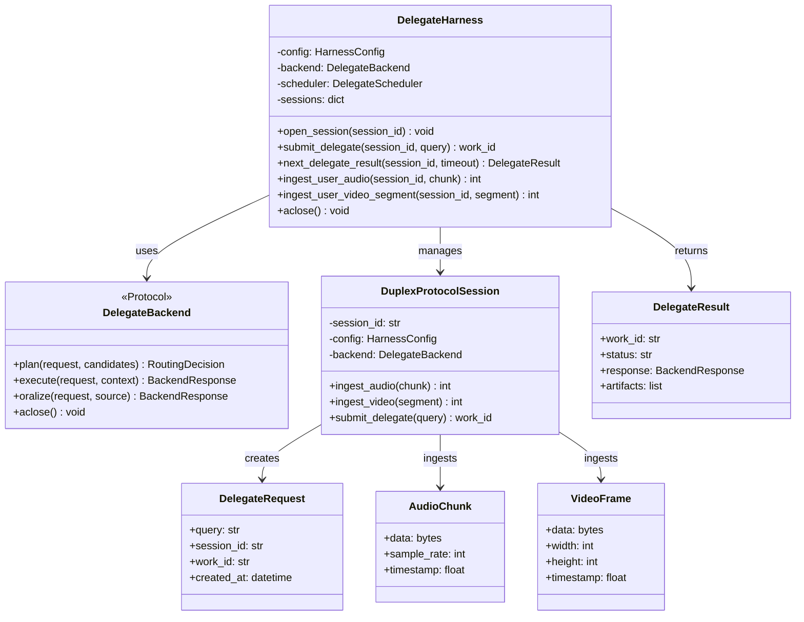

```python
# DelegateBackend 协议
class DelegateBackend(Protocol):
    async def plan(request, candidates) -> RoutingDecision: ...
    async def execute(request, context) -> BackendResponse: ...
    async def oralize(request, source) -> BackendResponse: ...
    async def aclose(self) -> None: ...

# DelegateHarness 使用示例
harness = DelegateHarness(backend=backend)
await harness.open_session("demo-session")
work_id = await harness.submit_delegate("demo-session", "创建1-100的平方表")
result = await harness.next_delegate_result("demo-session", timeout_s=180)
```

### 5.2 前端模型服务

#### 模型推理流程

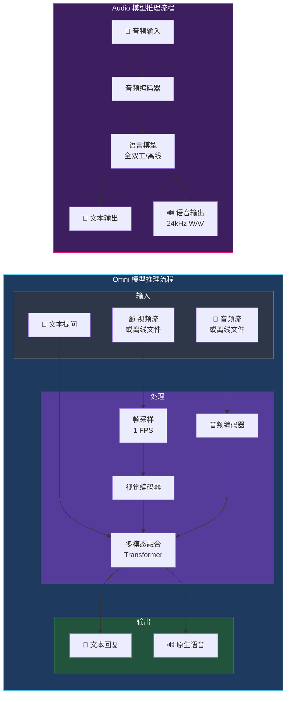

#### Realtime-Venus-Omni（视听模型）

| 示例 | 模式 | 输入 | 输出 |
|------|------|------|------|
| `offline_chat.py` | 半双工 | 视频 + 文本提问 | 文本 + 语音 |
| `offline_memory_chat.py` | 半双工 + 记忆 | 长视频 + 文本 | 文本 + 语音 |
| `duplex_chat.py` | 全双工 | 流式视频 + 文本注入 | 带字幕视频 |
| `duplex_speech_in_chat.py` | 全双工 | 流式视频（含语音） | 带字幕视频 |
| `duplex_memory_chat.py` | 全双工 + 记忆 | 长视频 + 文本 | 带字幕视频 |

#### Realtime-Venus-Audio（音频模型）

| 示例 | 模式 | 输入 | 输出 |
|------|------|------|------|
| `audio_offline_chat.py` | 离线 | 完整音频 | 文本 |
| `audio_duplex_chat.py` | 全双工 | 流式音频块 | 24kHz WAV |

### 5.3 Web Demo 服务

#### 全双工交互时序图

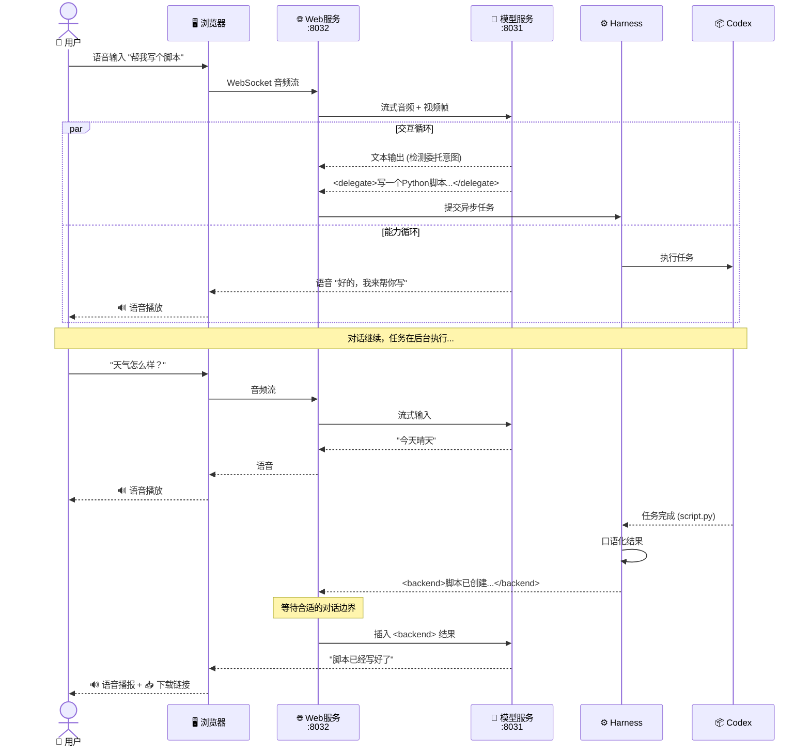

#### 服务组件职责

| 组件 | 职责 | 端口 |
|------|------|------|
| **Browser** | 采集设备/上传、流式输入、播放语音、显示进度 | - |
| **Web Service** | HTTP/WebSocket、会话管理、组件编排 | 8032 |
| **Session Host** | 媒体输入排序、模型输出消费、反馈调度 | - |
| **Model Service** | 加载权重、流式推理、语音生成 | 8031 |
| **Harness + Codex** | 任务执行、进度跟踪、结果交付 | - |

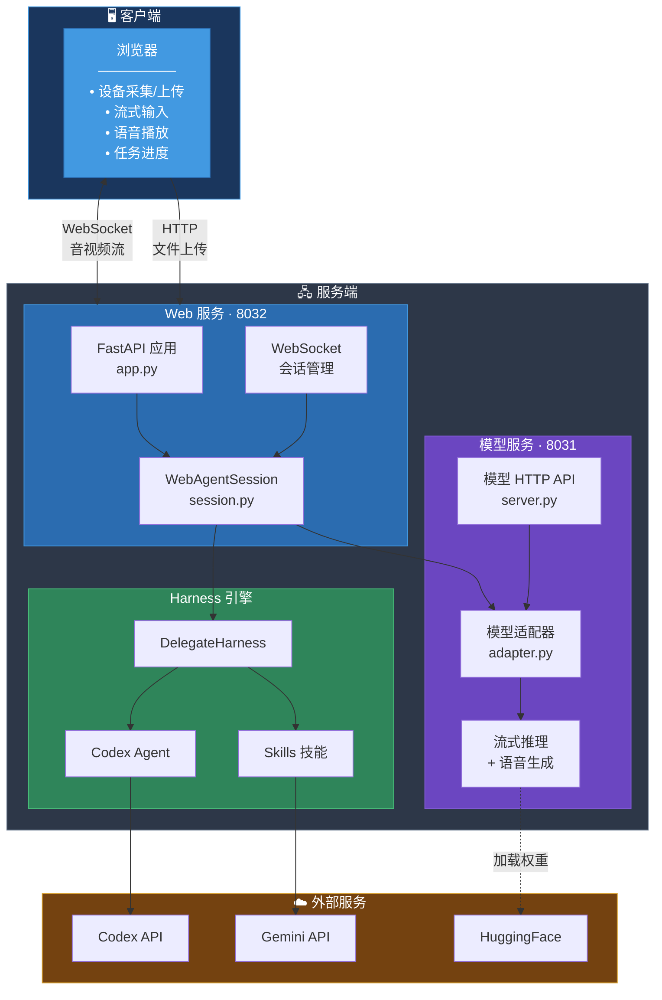

#### 输入模式

| 模式 | 功能 |
|------|------|
| **Audio · 麦克风** | 实时麦克风输入 |
| **Audio · 音频上传** | WAV/MP3/M4A/FLAC/OGG，最大 200MB |
| **Omni · 摄像头** | 摄像头 + 麦克风实时交互 |
| **Omni · 视频上传** | 本地视频文件，最大 200MB |

---

## 6. 配置系统

### 6.1 两份配置文件

#### 根 `config.json`（Demo 配置）

```json
{
  "model": {
    "type": "video",          // "audio" 或 "video"/"omni"
    "path": "Realtime-Venus-Omni",
    "reference_audio": "",     // 参考音频，空为默认
    "port": 8031,
    "memory_minutes": 40,      // Omni 视频记忆时长
    "length_penalty": 0.8,     // 语音长度惩罚 (0.1-5)
    "timeout_s": 180
  },
  "harness": {
    "config": "harness/config.json"
  },
  "web": {
    "host": "127.0.0.1",
    "port": 8032
  },
  "startup_timeout": 600
}
```

#### `harness/config.json`（Harness 配置）

主要配置组：

| 组 | 控制内容 |
|----|----------|
| `codex` | 执行器、模型、effort、超时 |
| `routing` | General/Auto 模式、Codex/Gemini、路由模型 |
| `responses` / `multimodal` | 独立的 Polish 和多模态提供者 |
| `gemini` | Gemini 模型和 API Key |
| `feedback` | 进度反馈、队列、技能预算 |
| `harness.delegate` | 请求/口语化超时、结果 TTL |
| `harness.result_management` | 静默窗口、队列、播放等待 |
| `harness.buffer` / `runtime` / `workspace` | 上下文保留、并发、存储 |

### 6.2 优先级

```
CLI 参数 > 环境变量 > 配置文件 > 默认值
```

关键环境变量：
- `VENUS_MODEL_TYPE`, `MODEL_PATH`, `AUDIO_MODEL_PATH` / `OMNI_MODEL_PATH`
- `REF_AUDIO`, `VENUS_MODEL_PORT`, `VENUS_MEMORY_MINUTES`
- `VENUS_WEB_HOST`, `VENUS_WEB_PORT`
- `HARNESS_CONFIG`
- `GEMINI_API_KEY` / `GOOGLE_API_KEY`

---

## 7. 部署与运行

### 7.1 部署架构

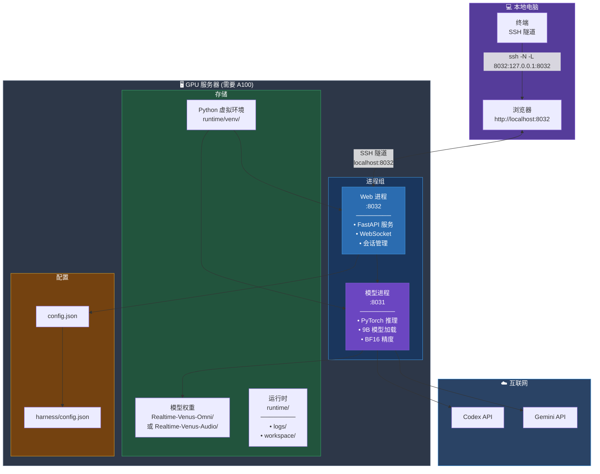

### 7.2 硬件要求

| 场景 | 最低要求 |
|------|----------|
| 离线推理 | Python 3.10, CUDA GPU, FFmpeg |
| 在线 Demo | **至少 1× NVIDIA A100 GPU** |

### 7.2 安装步骤

```bash
# 1. 安装下载器依赖
python -m pip install 'huggingface_hub>=0.34' 'PyYAML>=6.0'

# 2. 下载模型（选择其一）
python download_models.py --model omni --local-dir .    # 仅 Omni
python download_models.py --model audio --local-dir .   # 仅 Audio
python download_models.py --model all --local-dir .     # 全部

# 3. 安装对应依赖
python -m pip install -r Realtime-Venus-Omni/requirements.txt  # Omni
python -m pip install -r requirements.txt                       # Audio

# 4. Demo 完整安装（Linux）
bash install.sh
```

### 7.3 安装流程

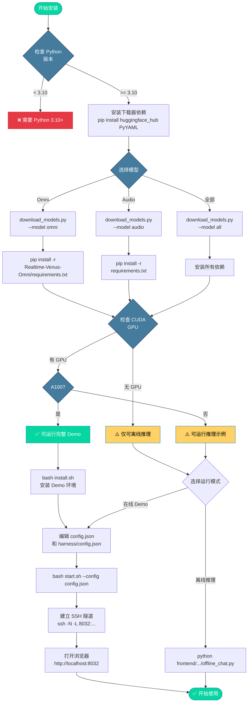

### 7.4 运行方式

#### 离线推理

```bash
# Omni 离线对话
export REALTIME_VENUS_MODEL_PATH=/path/to/Realtime-Venus-Omni
python frontend/Realtime-Venus-Omni/offline_chat.py

# Audio 全双工
python frontend/Realtime-Venus-Audio/audio_duplex_chat.py \
  --model-path /path/to/Realtime-Venus-Audio \
  --audio frontend/Realtime-Venus-Audio/case/case_duplex.wav \
  --output output/duplex_response.wav
```

#### 在线 Demo

```bash
# 启动服务
bash start.sh --config config.json

# 其他命令
bash start.sh --status              # 查看状态
bash start.sh --stop                # 停止服务
bash start.sh --check --no-login    # 预检查
bash start.sh --detach              # 后台启动
```

#### SSH 隧道访问

```bash
# 在本地电脑执行
ssh -N -L 8032:127.0.0.1:8032 user@server
# 然后打开 http://localhost:8032
```

---

## 8. 测试体系

测试文件位于 `tests/` 目录：

| 测试文件 | 覆盖范围 |
|----------|----------|
| `test_download_models.py` | 模型下载功能 |
| `test_gemini_provider.py` | Gemini 后端 |
| `test_media_recovery.py` | 媒体恢复 |
| `test_model_modes.py` | 模型模式 |
| `test_progress_opt_in.py` | 进度反馈 |
| `test_spoken_feedback.py` | 语音反馈 |
| `test_web_configuration.py` | Web 配置 |
| `test_workspace_settings.py` | 工作空间设置 |
| `test_deployment_config.py` | 部署配置 |
| `test_codex_login.py` | Codex 登录 |

---

## 9. 关键设计亮点

### 9.1 协议驱动的异步委托

系统使用 XML 风格的协议标记实现对话中的任务委托：

- `<delegate>...</delegate>`：模型输出，标记一个任务委托请求
- `<backend>...</backend>`：Harness 输出，标记返回的任务结果

这种设计让任务委托和结果返回都嵌入在自然对话流中，用户感知上是连续对话。

### 9.2 工作跟踪与交付分离

系统将 **任务完成** 与 **结果播报** 分离跟踪：

- 任务可能在后台完成，但不立即打断对话
- 在合适的输入边界（input boundary）才插入结果
- 播放完成后才标记为 DELIVERED

### 9.3 可插拔的后端架构

`DelegateBackend` 协议支持多种实现：

- **Codex**：默认 General 任务执行器
- **Gemini**：可选的 Routing/Polish/Multimodal 后端
- 可自行实现协议接入其他服务

### 9.4 独立的 Harness 包

Harness 设计为独立可发布的 Python 包：

- 不依赖 Demo、FastAPI 或前端模型权重
- 通过 `pyproject.toml` 独立打包
- 可单独安装用于其他应用

```bash
python -m pip install -e ./harness
```

---

## 10. 依赖关系图

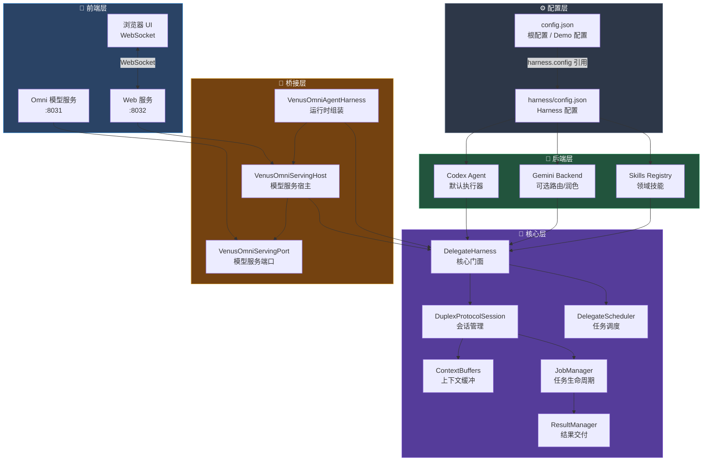

### 10.1 模块依赖详情

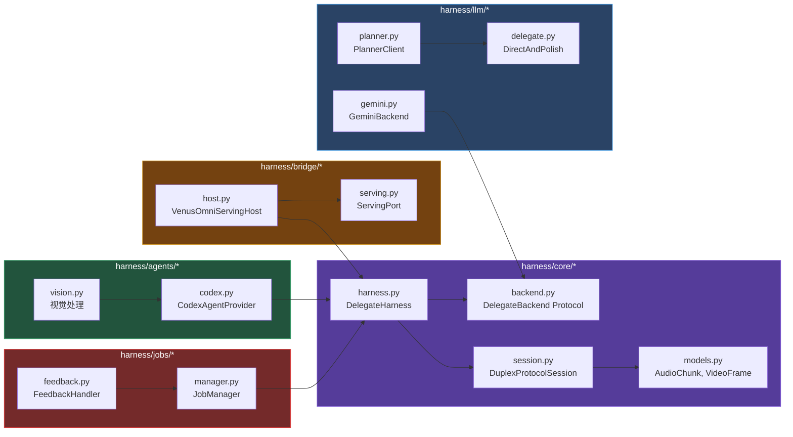

---

## 11. 文件统计

| 类别 | 数量 |
|------|------|
| Python 源文件 | ~70+ |
| 测试文件 | 10 |
| 配置文件 | 4 (JSON) |
| 文档 (Markdown) | 10+ |
| Shell 脚本 | 2 |

---

## 12. 适用场景

| 场景 | 适合度 | 说明 |
|------|--------|------|
| 实时语音助手 | ★★★★★ | 核心设计目标 |
| 音视频理解 | ★★★★★ | Omni 模型强项 |
| 任务型对话 | ★★★★★ | Harness 异步委托 |
| 长视频交互 | ★★★★☆ | 支持 40 分钟记忆 |
| 纯文本对话 | ★★☆☆☆ | 非主要设计目标 |
| 离线批处理 | ★★★☆☆ | 有示例但非重点 |

---

## 13. 限制与注意事项

1. **硬件要求高**：在线 Demo 需要至少一张 A100 GPU
2. **单会话限制**：当前版本只支持一个活跃对话
3. **网络依赖**：Codex 后端需要网络连接和登录
4. **模型体积大**：9B 参数模型需要较大显存和存储
5. **Gemini 限制**：内联请求超过 20MB 会失败
6. **SSH 隧道**：远程访问需要手动建立 SSH 隧道
7. **Python 版本**：Harness 需要 Python 3.11+，推理示例可用 3.10

---

## 14. 相关资源

| 资源 | 链接 |
|------|------|
| 项目主页 | https://realtime-venus.github.io/ |
| GitHub | https://github.com/inclusionAI/Realtime-Venus |
| Hugging Face | https://huggingface.co/inclusionAI/Realtime-Venus |
| ModelScope | https://www.modelscope.cn/models/inclusionAI/Realtime-Venus |
| 论文 | https://arxiv.org/pdf/2609.13814 |
| Android Demo | [APK 下载](https://github.com/inclusionAI/Realtime-Venus/releases/download/android-beta-0918/Realtime-Venus-0918.apk) |

---

## 15. 引用

```bibtex
@article{zhao2026realtime,
  title={{Realtime-Venus}: A full-duplex interaction system with asynchronous delegation},
  author={{Venus Team(Ant Group), Tsinghua University}},
  journal={arXiv preprint arXiv:2609.13814},
  year={2026}
}
```

---

*本报告由 Claude Opus 5 自动生成，基于项目源码和文档分析。*
