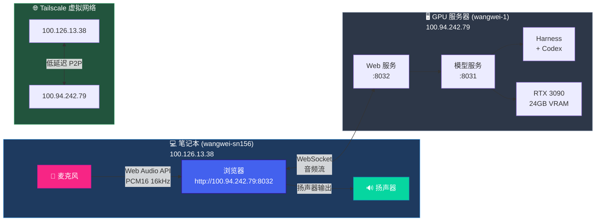
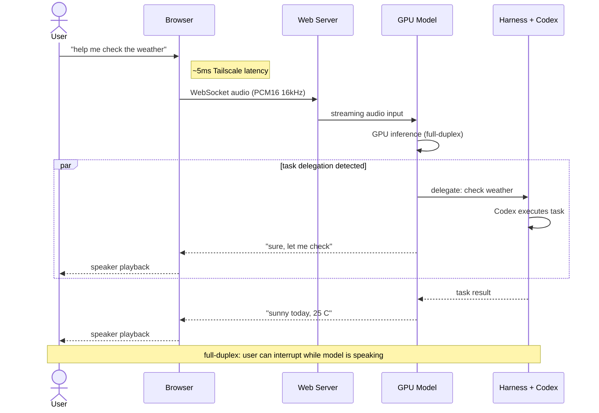
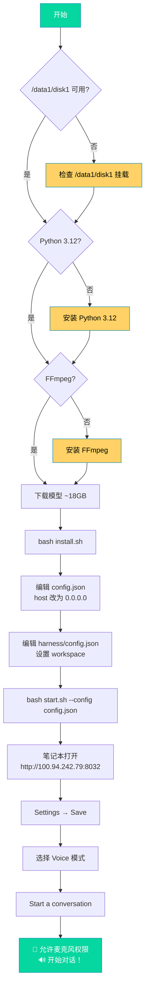

# Realtime-Venus 远程全双工语音部署方案

> **场景**：GPU 服务器（无麦克风/扬声器）通过 Tailscale 连接笔记本（有麦克风/扬声器）  
> **网络**：笔记本 ↔ Tailscale ↔ GPU 服务器  
> **原理**：浏览器在笔记本上采集音频 → WebSocket 传到 GPU → 模型推理 → TTS 音频回传 → 笔记本扬声器播放

---

## 0. 当前环境评估

| 项目 | 状态 | 说明 |
|------|------|------|
| **GPU** | ✅ RTX 3090 (24GB) | 足够跑 9B 模型（BF16 约需 ~18GB 显存） |
| **NVIDIA 驱动** | ✅ 595.99.02 | CUDA 13.2 |
| **Tailscale** | ✅ 100.94.242.79 | 已联网 |
| **Codex** | ✅ 已安装 | `/home/wangwei/.nvm/versions/node/v24.20.0/bin/codex` |
| **Python 3.10** | ✅ 可用 | 可用于推理示例 |
| **Python 3.11+** | ❌ 缺失 | Demo 的 Harness 需要 3.11 或 3.12 |
| **FFmpeg** | ❌ 缺失 | 音视频处理必需 |
| **模型存储** | ✅ `/data1/disk1` 47GB 可用 | 模型下载到此盘，避开 `/home` 空间不足 |

### 存储方案

`/home` 仅有 6GB，模型权重约 18GB，放不下。使用 `/data1/disk1`（47GB 可用）存放模型：

```text
/data1/disk1/
├── Realtime-Venus-Audio/   # Audio 模型 (~18GB)
└── Realtime-Venus-Omni/    # 或 Omni 模型
```

---

## 1. 整体架构



**关键点**：
- 麦克风和扬声器在**笔记本浏览器**上工作
- 音频通过 WebSocket 在**浏览器和 GPU 服务器**之间实时传输
- Tailscale 提供低延迟的 P2P 连接，延迟通常 < 5ms
- 不需要 SSH 隧道，直接用 Tailscale IP 访问

---

## 2. 环境准备

### 2.1 准备模型存储目录

模型下载到 `/data1/disk1`（47GB 可用），避开 `/home` 的 6GB 限制：

```bash
# 确认 /data1/disk1 可用
df -h /data1/disk1

# 创建目录（可选，下载器会自动创建）
mkdir -p /data1/disk1
```

### 2.2 安装 Python 3.12

```bash
# 方法一：通过 deadsnakes PPA
sudo add-apt-repository ppa:deadsnakes/ppa
sudo apt update
sudo apt install python3.12 python3.12-venv python3.12-dev

# 验证
python3.12 --version

# 方法二：如果无 sudo 权限，用 pyenv
curl https://pyenv.run | bash
echo 'export PYENV_ROOT="$HOME/.pyenv"' >> ~/.bashrc
echo 'command -v pyenv >/dev/null || export PATH="$PYENV_ROOT/bin:$PATH"' >> ~/.bashrc
echo 'eval "$(pyenv init -)"' >> ~/.bashrc
source ~/.bashrc

pyenv install 3.12.8
pyenv global 3.12.8
```

### 2.3 安装 FFmpeg

```bash
# 方法一：apt
sudo apt update && sudo apt install ffmpeg

# 方法二：conda（如果安装了 conda）
conda install -c conda-forge ffmpeg

# 方法三：静态二进制（无 sudo）
mkdir -p ~/bin
wget https://johnvansickle.com/ffmpeg/builds/ffmpeg-release-amd64-static.tar.xz
tar xf ffmpeg-release-amd64-static.tar.xz
cp ffmpeg-*-amd64-static/ffmpeg ~/bin/
cp ffmpeg-*-amd64-static/ffprobe ~/bin/
export PATH="$HOME/bin:$PATH"  # 加到 .bashrc

# 验证
ffmpeg -version
```

### 2.4 验证环境

```bash
python3.12 --version   # Python 3.12.x
ffmpeg -version        # ffmpeg 6.x+
nvidia-smi             # RTX 3090
tailscale status       # 100.94.242.79
which codex            # codex 路径
codex login status     # Codex 登录状态
```

---

## 3. 安装 Realtime-Venus

### 3.1 下载模型

```bash
cd /home/wangwei/wei/workspacePy/sound/Realtime-Venus

# 安装下载器依赖
python3.12 -m pip install 'huggingface_hub>=0.34' 'PyYAML>=6.0'

# 下载 Audio 模型（~18GB）到 /data1/disk1
python3.12 download_models.py --model audio --local-dir /data1/disk1

# 或者下载 Omni 模型（支持视频，更大）
# python3.12 download_models.py --model omni --local-dir /data1/disk1
```

### 3.2 安装 Demo 环境

```bash
# 指定 Python 3.12 给安装脚本
export PYTHON_BIN=$(which python3.12)
bash install.sh
```

### 3.3 配置

编辑 `config.json`，**关键改动**是将 `web.host` 设为 Tailscale IP 或 `0.0.0.0`：

```json
{
  "model": {
    "type": "audio",
    "path": "/data1/disk1/Realtime-Venus-Audio",
    "reference_audio": "",
    "port": 8031,
    "memory_minutes": 40,
    "length_penalty": 0.8,
    "timeout_s": 180
  },
  "harness": {
    "config": "harness/config.json"
  },
  "web": {
    "host": "0.0.0.0",
    "port": 8032
  },
  "startup_timeout": 600
}
```

> ⚠️ **`host` 必须改为 `0.0.0.0`**，默认 `127.0.0.1` 只接受本机连接，笔记本无法访问。  
> 改为 `0.0.0.0` 后，只有 Tailscale 网络内能访问（安全）。  
> 也可以设为 `100.94.242.79` 只监听 Tailscale 网卡。

编辑 `harness/config.json`，设置任务工作目录：

```json
{
  "workspace": "/home/wangwei/wei/workspacePy/sound/Realtime-Venus/runtime/workspace",
  ...
}
```

---

## 4. 启动服务

```bash
cd /home/wangwei/wei/workspacePy/sound/Realtime-Venus

# 启动
bash start.sh --config config.json

# 或后台启动
bash start.sh --config config.json --detach

# 查看状态
bash start.sh --status
```

---

## 5. 笔记本浏览器连接

### 5.1 直接访问（推荐）

在笔记本浏览器中打开：

```
http://100.94.242.79:8032
```

**为什么 HTTP 也能用麦克风？**  
Tailscale 的 IP 地址（100.x.x.x）属于私有地址，现代浏览器将私有网络上的页面视为**安全上下文**（Secure Context），即使使用 HTTP 也允许访问麦克风。这是浏览器的标准行为，不是安全漏洞。

### 5.2 首次使用步骤

1. 打开 `http://100.94.242.79:8032`
2. 点击 **Settings** 按钮
3. 填写 **Task workspace**：服务器上的任务目录
4. 检查 **Codex login** 状态
5. 点击 **Save settings**
6. 选择 **Voice** 模式（麦克风）
7. 点击 **Start a conversation**
8. 浏览器会弹出麦克风权限请求 → **允许**
9. 开始对话！

### 5.3 音频流程



---

## 6. 性能优化建议

### 6.1 降低延迟

| 优化项 | 操作 | 效果 |
|--------|------|------|
| Tailscale DERP 中继 | 默认自动 P2P 直连 | 延迟 < 5ms |
| 音频块大小 | 默认 1 秒/块 | 已足够好 |
| length_penalty | 设为 0.5-0.8 | 更快结束发言轮次 |

### 6.2 Tailscale 连接验证

```bash
# 在笔记本上检查到 GPU 机器的延迟
ping -c 5 100.94.242.79

# 检查是否是直连（非中继）
tailscale status 2>/dev/null | grep wangwei-1
# 如果显示 "via 1.2.3.4:41641" 是直连 ✅
# 如果显示 "via DERP" 是中继 ⚠️（延迟会高一些，约 50-100ms）
```

### 6.3 GPU 显存优化

RTX 3090 有 24GB 显存，9B 模型 BF16 约占 ~18GB，余量不大：

```bash
# 监控显存使用
watch -n 2 nvidia-smi

# 如果 OOM，可以：
# 1. 关闭其他占用 GPU 的进程
# 2. 使用 Audio 模型而非 Omni（更小）
# 3. 减小 memory_minutes
```

---

## 7. 常见问题

### Q1: 浏览器提示"不安全"无法使用麦克风？

Tailscale IP（100.x.x.x）是私有地址，现代浏览器应该视为安全上下文。如果仍然不行：

```bash
# 方案 A：在 chrome://flags 中添加例外
# 打开 chrome://flags/#unsafely-treat-insecure-origin-as-secure
# 添加 http://100.94.242.79:8032

# 方案 B：用 SSH 隧道代替（绕过此问题）
# 在笔记本上执行：
ssh -N -L 8032:127.0.0.1:8032 wangwei@100.94.242.79
# 然后浏览器打开 http://localhost:8032
```

### Q2: 音频延迟很高？

```bash
# 1. 确认 Tailscale 是直连
tailscale status

# 2. 如果是 DERP 中继，检查 NAT 穿透
# 确保路由器开启了 UPnP 或手动转发 Tailscale 端口

# 3. 检查网络抖动
ping -c 20 100.94.242.79 | grep rtt
```

### Q3: 连接被拒绝？

```bash
# 检查服务是否在监听
ss -tlnp | grep -E '8031|8032'

# 检查防火墙
sudo ufw status
# 如果启用了防火墙，放行 Tailscale：
sudo ufw allow in on tailscale0

# 检查 web.host 配置
cat config.json | grep host
# 必须是 "0.0.0.0" 或 "100.94.242.79"，不能是 "127.0.0.1"
```

### Q4: Codex 登录失败？

```bash
# 检查 Codex 登录状态
codex login status

# 如果需要登录
codex login --device-auth
# 按提示在浏览器中完成认证
```

### Q5: 模型加载 OOM？

```bash
# 检查显存
nvidia-smi

# 杀掉其他 GPU 进程
fuser -v /dev/nvidia* 2>/dev/null
# 或
nvidia-smi | grep -E "MiB|%" | head

# 使用 Audio 模型（比 Omni 小一些）
# 在 config.json 中设置 "type": "audio"
```

### Q6: 笔记本合盖后连接断开？

```bash
# 方案 A：禁止笔记本休眠
# Linux:
systemctl mask sleep.target suspend.target hibernate.target hybrid-sleep.target

# 方案 B：保持终端活跃
# 在笔记本上也安装 Tailscale 并设置永不休眠
```

---

## 8. 安全注意事项

| 方面 | 说明 |
|------|------|
| **网络隔离** | Tailscale 网络是私有的，只有你的设备能访问 |
| **Gemini API Key** | 通过浏览器设置后保存在服务器，权限 0600 |
| **Codex 登录** | 服务器端认证，不要在共享机器上使用 |
| **防火墙** | Tailscale 流量默认走 `tailscale0` 网卡，与公网隔离 |
| **单会话限制** | 同一时间只允许一个对话 |

---

## 9. 快速启动清单



---

## 10. 一键启动脚本

等环境准备好后，创建一个便捷的启动脚本：

```bash
#!/bin/bash
# /home/wangwei/wei/workspacePy/sound/Realtime-Venus/start-remote.sh
# 远程全双工语音启动脚本

set -e
cd "$(dirname "$0")"

TAILSCALE_IP=$(tailscale ip -4 2>/dev/null | head -1)
echo "====================================="
echo "  Realtime-Venus 远程语音 Demo"
echo "====================================="
echo ""
echo "  Tailscale IP: ${TAILSCALE_IP}"
echo "  访问地址:     http://${TAILSCALE_IP}:8032"
echo ""
echo "  在笔记本浏览器中打开上面的地址"
echo "  选择 Voice 模式，点击 Start"
echo "====================================="
echo ""

# 确保 host 设为 0.0.0.0
python3 -c "
import json
with open('config.json') as f:
    cfg = json.load(f)
if cfg.get('web',{}).get('host') == '127.0.0.1':
    cfg['web']['host'] = '0.0.0.0'
    with open('config.json','w') as f:
        json.dump(cfg, f, indent=2)
    print('  ✅ 已将 web.host 改为 0.0.0.0')
else:
    print(f'  ✅ web.host = {cfg.get(\"web\",{}).get(\"host\",\"未设置\")}')
"

echo ""
echo "  正在启动服务..."
echo ""

exec bash start.sh --config config.json "$@"
```

---

*方案基于 Tailscale 100.94.242.79 (GPU) ↔ 100.126.13.38 (笔记本) 网络环境。*

---

## 附录：部署状态记录（2026-11-14）

### 当前状态：⚠️ 部分可用

- ✅ 服务可正常启动和运行
- ✅ 模型可加载（4-bit FP4 量化，10.7GB 显存）
- ✅ 能听到 1-2 句语音回复（如 "能听到"）
- ❌ **无法维持持续全双工对话**：模型在 1-2 句后停止生成语音
- ❌ RTX 3090 (24GB) 显存不足以全精度运行 9B 模型 + TTS（需 ~22GB）

### 根本原因

量化（8-bit/4-bit）破坏了模型的语音 token 生成能力。4-bit FP4 是目前最好的结果，但仍不足以支持持续对话。详见 `部署记录.md`。

### 当前配置

- 量化方式：4-bit FP4（`sitecustomize.py` 钩子）
- TTS 模块：全精度（跳过量化）
- 显存占用：10.7GB / 24GB
- 笔记本访问：SSH 隧道 → `http://localhost:8032`

### 推荐方案

如需完整的全双工语音体验，建议使用 **云端 A100 40GB GPU** 或升级本地 GPU。
离线推理示例可正常运行（详见项目 README）。
