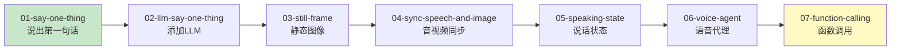
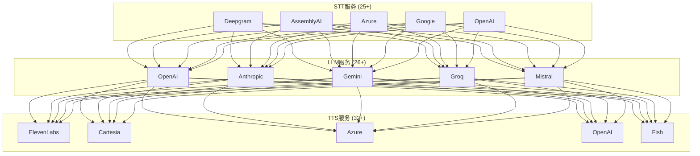
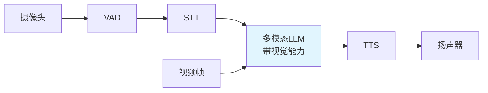
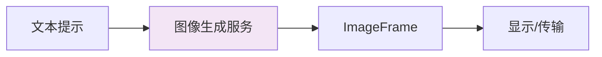
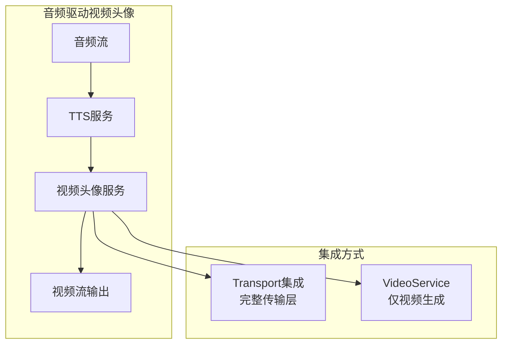
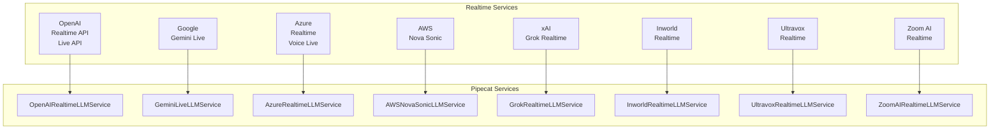
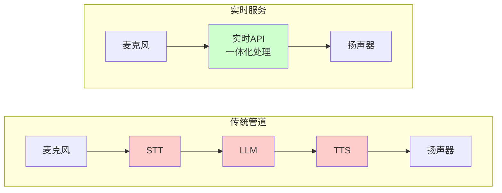

# Pipecat 示例分析

> 分析日期: 2026-11-15  
> 项目: `pipecat-main/examples/`

---

## 目录

- [1. Getting Started 入门教程](#1-getting-started-入门教程)
- [2. Voice 语音代理](#2-voice-语音代理)
- [3. Vision 视觉能力](#3-vision-视觉能力)
- [4. Image Generation 图像生成](#4-image-generation-图像生成)
- [5. Video Avatar 视频头像](#5-video-avatar-视频头像)
- [6. Expressive Conversation 表情对话](#6-expressive-conversation-表情对话)
- [7. Realtime 实时服务](#7-realtime-实时服务)

---

## 1. Getting Started 入门教程

`getting-started/` 目录包含 **10个递进式示例**，帮助初学者逐步学习 Pipecat 基础。

### 1.1 学习路径



### 1.2 示例文件清单

| 文件 | 功能 | 核心概念 |
|------|------|----------|
| `01-say-one-thing.py` | TTS说出文本 | TTSSpeakFrame, 基础管道 |
| `01a-local-audio.py` | 本地音频播放 | LocalTransport |
| `02-llm-say-one-thing.py` | LLM生成后TTS | LLMContext, OpenAI |
| `03-still-frame.py` | 显示静态图像 | ImageFrame, 视频帧 |
| `03a-local-still-frame.py` | 本地显示图像 | 本地传输 |
| `04-sync-speech-and-image.py` | 语音+图像同步 | 多模态管道 |
| `05-speaking-state.py` | 检测说话状态 | VAD, 状态事件 |
| `06-voice-agent.py` | 完整语音代理 | STT+LLM+TTS |
| `06a-voice-agent-local.py` | 本地语音代理 | 本地音频 |
| `07-function-calling.py` | 函数调用 | @tool装饰器 |

### 1.3 核心代码示例

**基础语音代理 (06-voice-agent.py)**:

```python
# 管道结构: STT → LLM Context → LLM → TTS
pipeline = Pipeline([
    stt,  # Deepgram STT
    context_aggregator.user(),
    llm,  # OpenAI LLM
    tts,  # Cartesia TTS
    context_aggregator.assistant(),
])
```

---

## 2. Voice 语音代理

`voice/` 目录包含 **85+个示例**，展示各种 STT+LLM+TTS 组合。

### 2.1 服务分类



### 2.2 示例分类

#### 按STT服务分类

| STT服务 | 示例文件 |
|---------|----------|
| Deepgram | `voice-deepgram.py`, `voice-deepgram-flux.py`, `voice-deepgram-http.py` |
| AssemblyAI | `voice-assemblyai.py`, `voice-assemblyai-sync.py`, `voice-assemblyai-turn-detection.py` |
| Azure | `voice-azure.py`, `voice-azure-http.py` |
| Google | `voice-google.py`, `voice-google-http.py`, `voice-google-gemini.py` |
| OpenAI | `voice-openai.py`, `voice-openai-http.py`, `voice-openai-turn-detection.py` |
| AWS | `voice-aws.py`, `voice-aws-strands.py` |
| 其他 | `voice-gladia.py`, `voice-moonshine.py`, `voice-speechmatics.py` |

#### 按LLM服务分类

| LLM服务 | 示例文件 |
|---------|----------|
| OpenAI | `voice-openai.py`, `voice-openai-responses.py` |
| Google | `voice-google-gemini.py` |
| Groq | `voice-groq.py` |
| Mistral | `voice-mistral.py` |
| xAI | `voice-xai.py`, `voice-xai-http.py` |
| LangChain | `voice-langchain.py` |

#### 按TTS服务分类

| TTS服务 | 示例文件 |
|---------|----------|
| ElevenLabs | `voice-elevenlabs.py`, `voice-elevenlabs-dialogue.py` |
| Cartesia | `voice-cartesia.py`, `voice-cartesia-http.py`, `voice-cartesia-turns.py` |
| Azure | `voice-azure.py` |
| OpenAI | `voice-openai.py` |
| Fish | `voice-fish.py` |
| Kokoro | `voice-kokoro.py` |
| Rime | `voice-rime.py`, `voice-rime-v1.py` |
| 其他 | `voice-resemble.py`, `voice-xtts.py`, `voice-pockettts.py` |

### 2.3 特殊功能示例

| 功能 | 示例文件 |
|------|----------|
| 噪声过滤 | `voice-krisp-viva.py`, `voice-aicoustics.py` |
| 轮次检测 | `voice-assemblyai-turn-detection.py`, `voice-openai-turn-detection.py` |
| HTTP模式 | `voice-*-http.py` (多个服务) |
| SageMaker | `voice-deepgram-sagemaker.py`, `voice-nvidia-sagemaker.py` |
| 对话模式 | `voice-elevenlabs-dialogue.py` |

---

## 3. Vision 视觉能力

`vision/` 目录包含 **8个示例**，展示图像理解和视觉问答能力。

### 3.1 架构



### 3.2 示例文件清单

| 文件 | 服务 | 功能 |
|------|------|------|
| `vision-openai.py` | OpenAI GPT-4V | 基础视觉问答 |
| `vision-openai-responses.py` | OpenAI Responses API | Responses API模式 |
| `vision-openai-responses-http.py` | OpenAI HTTP | HTTP模式 |
| `vision-anthropic.py` | Claude | Claude视觉 |
| `vision-gemini-flash.py` | Gemini Flash | 快速视觉 |
| `vision-google-interactions.py` | Google | Google视觉 |
| `vision-aws.py` | AWS | AWS视觉 |
| `vision-moondream.py` | Moondream | 本地视觉模型 |

### 3.3 核心代码

```python
# 视觉上下文包含图像帧
context = LLMContext([
    {"role": "user", "content": [
        {"type": "text", "text": "描述你看到的"},
        {"type": "image", "image": image_base64}
    ]}
])
```

---

## 4. Image Generation 图像生成

`image-generation/` 目录包含 **3个示例**，展示AI图像生成能力。

### 4.1 示例文件清单

| 文件 | 服务 | 功能 |
|------|------|------|
| `image-generation-openai.py` | OpenAI DALL-E | DALL-E图像生成 |
| `image-generation-google.py` | Google Imagen | Imagen图像生成 |
| `image-generation-fal.py` | fal.ai | fal.ai模型 |

### 4.2 架构



### 4.3 核心代码

```python
# 图像生成服务
image_gen = OpenAIImageGenService()

# 生成图像
frame = TextFrame("a cat in the style of picasso")
await image_gen.process_frame(frame)
# 输出: ImageFrame
```

---

## 5. Video Avatar 视频头像

`video-avatar/` 目录包含 **6个示例**，展示数字人/视频头像集成。

### 5.1 支持的服务

| 服务 | 示例文件 | 集成方式 |
|------|----------|----------|
| Tavus | `video-avatar-tavus-transport.py` | Transport |
| Tavus | `video-avatar-tavus-video-service.py` | Video Service |
| HeyGen | `video-avatar-heygen-transport.py` | Transport |
| HeyGen | `video-avatar-heygen-video-service.py` | Video Service |
| Simli | `video-avatar-simli-video-service.py` | Video Service |
| LemonSlice | `video-avatar-lemonslice-transport.py` | Transport |

### 5.2 架构



### 5.3 Transport vs VideoService

| 集成方式 | 说明 | 适用场景 |
|----------|------|----------|
| **Transport** | 完整传输层，替代Daily/LiveKit | 端到端数字人方案 |
| **VideoService** | 仅视频生成服务 | 与其他传输层组合 |

---

## 6. Expressive Conversation 表情对话

`expressive-conversation/` 目录包含 **13个示例**，展示带表情/情感的语音对话。

### 6.1 支持的服务

| 服务 | 示例文件 | 表情能力 |
|------|----------|----------|
| ElevenLabs | `expressive-conversation-elevenlabs.py` | 情感语音 |
| Cartesia | `expressive-conversation-cartesia.py` | 情感标记 |
| Azure | `expressive-conversation-azure.py` | SSML表情 |
| Gemini | `expressive-conversation-gemini.py` | 多模态表情 |
| Hume | `expressive-conversation-hume-audio-decisions.py` | 情感检测 |
| Fish | `expressive-conversation-fish.py` | 中文情感 |
| Inworld | `expressive-conversation-inworld.py` | 角色表情 |
| MiniMax | `expressive-conversation-minimax.py` | 情感合成 |
| Mistral | `expressive-conversation-mistral.py` | 文本情感 |
| Soniox | `expressive-conversation-soniox.py` | 情感识别 |
| Tone | `expressive-conversation-tone.py` | 语调控制 |
| Voice Reader | `expressive-conversation-voice-reader.py` | 朗读情感 |

### 6.2 表情系统架构

```mermaid
graph TB
    subgraph "表情对话管道"
        STT[STT<br/>语音识别] --> LLM[LLM<br/>情感理解]
        LLM --> TTS[TTS<br/>情感合成]
        TTS --> Audio[音频输出]
    end

    subgraph "表情控制"
        LLM --> Tags[表情标签<br/>如 [happy], [sad]]
        Tags --> TTS
        TTS --> Policy[ExpressionPolicy<br/>表情策略]
    end

    subgraph "表情类型"
        Delivery[Delivery<br/>语调、节奏]
        Sound[Sound<br/>笑声、叹息]
    end

    Policy --> Delivery & Sound

    style TTS fill:#fce4ec
    style Policy fill:#f3e5f5
```

### 6.3 表情标签示例

```python
# 表情标签
ExpressionDelivery.HAPPY    # 快乐语调
ExpressionDelivery.SAD      # 悲伤语调
ExpressionSound.LAUGH       # 笑声
ExpressionSound.SIGH        # 叹息

# LLM输出示例
"我太开心了！[laugh] 这真是太棒了！"
```

---

## 7. Realtime 实时服务

`realtime/` 目录包含 **30+个示例**，使用实时AI服务（Speech-to-Speech）。

这些示例调用的是第三方 **S2S** 或 **实时多模态** 服务，特点是：
- 🎤 直接音频输入 → 音频输出
- ⚡ 超低延迟（无需单独的STT+TTS管道）
- 🔊 支持实时中断
- 🌊 流式处理

### 7.1 支持的实时服务



### 7.2 服务分类

| 服务商 | Pipecat服务类 | 协议类型 |
|--------|---------------|----------|
| OpenAI | `OpenAIRealtimeLLMService` | WebSocket |
| OpenAI (Live) | `OpenAILiveLLMService` | HTTP/2 Streaming |
| Google | `GeminiLiveLLMService` | WebSocket |
| Google (Vertex) | `GeminiLiveVertexLLMService` | gRPC |
| Azure | `AzureRealtimeLLMService` | WebSocket |
| Azure (Voice Live) | `AzureVoiceLiveLLMService` | WebSocket |
| AWS | `AWSNovaSonicLLMService` | WebSocket |
| xAI | `GrokRealtimeLLMService` | WebSocket |
| Inworld | `InworldRealtimeLLMService` | WebSocket |
| Ultravox | `UltravoxRealtimeLLMService` | WebSocket |
| Zoom AI | `ZoomAIRealtimeLLMService` | WebSocket |

### 7.3 示例文件清单

#### OpenAI Realtime

| 文件 | 功能 |
|------|------|
| `realtime-openai.py` | 基础实时对话 |
| `realtime-openai-async-tool.py` | 异步工具调用 |
| `realtime-openai-locally-driven-turns.py` | 本地轮次控制 |
| `realtime-openai-text.py` | 文本输入模式 |
| `realtime-openai-video.py` | 视频输入 |
| `realtime-openai-live-client-delegation.py` | 客户端委托 |
| `realtime-openai-live-client-delegation-speaking-policy.py` | 说话策略 |
| `realtime-openai-live-responses-delegation.py` | 响应委托 |

#### Google Gemini Live

| 文件 | 功能 |
|------|------|
| `realtime-gemini-live.py` | 基础实时对话 |
| `realtime-gemini-live-async-tool.py` | 异步工具调用 |
| `realtime-gemini-live-files-api.py` | 文件API集成 |
| `realtime-gemini-live-google-search.py` | Google搜索集成 |
| `realtime-gemini-live-graceful-end.py` | 优雅结束 |
| `realtime-gemini-live-grounding-metadata.py` | 基础元数据 |
| `realtime-gemini-live-locally-driven-turns.py` | 本地轮次控制 |
| `realtime-gemini-live-vertex.py` | Vertex AI版本 |
| `realtime-gemini-live-video.py` | 视频输入 |

#### Azure Realtime

| 文件 | 功能 |
|------|------|
| `realtime-azure.py` | 基础实时对话 |
| `realtime-azure-async-tool.py` | 异步工具调用 |
| `realtime-azure-voice-live.py` | Voice Live服务 |

#### 其他服务

| 文件 | 功能 |
|------|------|
| `realtime-aws-nova-sonic.py` | AWS Nova Sonic |
| `realtime-grok.py` | xAI Grok |
| `realtime-inworld.py` | Inworld |
| `realtime-ultravox.py` | Ultravox |
| `realtime-zoom-ai.py` | Zoom AI |

### 7.4 与传统管道对比



### 7.5 服务对比

| 服务 | 延迟 | 质量 | 工具调用 | 视频 | 多语言 |
|------|------|------|----------|------|--------|
| OpenAI Realtime | ⭐⭐⭐⭐⭐ | ⭐⭐⭐⭐ | ✅ | ✅ | ✅ |
| Gemini Live | ⭐⭐⭐⭐ | ⭐⭐⭐⭐ | ✅ | ✅ | ✅ |
| Azure Realtime | ⭐⭐⭐⭐ | ⭐⭐⭐⭐⭐ | ✅ | ❌ | ✅ |
| AWS Nova Sonic | ⭐⭐⭐ | ⭐⭐⭐⭐ | ✅ | ❌ | ✅ |
| Grok Realtime | ⭐⭐⭐⭐ | ⭐⭐⭐⭐ | ✅ | ❌ | ✅ |

---

## 8. 环境变量配置

### 通用配置

```bash
# OpenAI
OPENAI_API_KEY=sk-...

# Google Gemini
GOOGLE_API_KEY=...

# Azure
AZURE_API_KEY=...
AZURE_REGION=...

# Deepgram
DEEPGRAM_API_KEY=...

# ElevenLabs
ELEVENLABS_API_KEY=...

# Cartesia
CARTEISA_API_KEY=...
```

### 实时服务配置

```bash
# AWS
AWS_ACCESS_KEY_ID=...
AWS_SECRET_ACCESS_KEY=...
AWS_REGION=...

# xAI Grok
XAI_API_KEY=...

# Inworld
INWORLD_API_KEY=...

# Ultravox
ULTRAVOX_API_KEY=...

# Zoom AI
ZOOM_AI_API_KEY=...
```

---

*本文档由 Claude Opus 5 自动生成*
