# Pipecat AI 项目分析

> 分析日期: 2026-11-14  
> 项目版本: 动态版本 (setuptools_scm管理)  
> 项目路径: `/home/wangwei/wei/workspacePy/sound/pipecat-main`

---

## 目录

- [1. 项目概述](#1-项目概述)
- [2. 项目结构](#2-项目结构)
- [3. 技术栈](#3-技术栈)
- [4. 核心架构](#4-核心架构)
- [5. 服务集成](#5-服务集成)
- [6. 传输层](#6-传输层)
- [7. 示例代码](#7-示例代码)
- [8. 开发配置](#8-开发配置)
- [9. 生态系统](#9-生态系统)
- [10. 总结](#10-总结)

---

## 1. 项目概述

### 基本信息

| 属性 | 值 |
|------|-----|
| **项目名称** | Pipecat AI (pipecat-ai) |
| **描述** | 开源的Python框架，用于构建实时语音和多模态对话AI代理 |
| **许可证** | BSD-2-Clause |
| **开发组织** | Daily (Copyright 2024-2026) |
| **官方网站** | https://pipecat.ai |
| **文档** | https://docs.pipecat.ai |
| **GitHub** | https://github.com/pipecat-ai/pipecat |

### 核心定位

Pipecat是一个专注于**实时语音和多模态对话AI**的框架，支持以下场景：

- 🎤 语音助手 (Voice Assistants)
- 🤖 多代理系统 (Multi-Agent Systems)
- 💬 AI伴侣 (AI Companions)
- 🎥 多模态界面 (Multimodal Interfaces)
- 📖 交互式故事创作 (Interactive Storytelling)
- 💼 商业代理 (Business Agents)
- 🔧 复杂对话系统 (Complex Dialog Systems)

---

## 2. 项目结构

### 2.1 项目结构总览

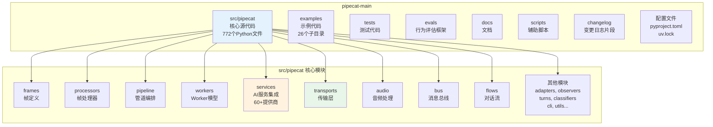

### 2.2 根目录结构

```
pipecat-main/
├── src/pipecat/          # 核心源代码 (772个Python文件)
├── examples/             # 示例代码 (26个子目录)
├── tests/                # 测试代码
├── evals/                # 行为评估框架
├── docs/                 # 文档
│   ├── api/             # API文档
│   └── architecture/    # 架构文档
├── scripts/              # 辅助脚本
├── changelog/            # 变更日志片段
├── pyproject.toml        # 项目配置
├── uv.lock              # 依赖锁定文件
├── README.md            # 项目说明
├── AGENTS.md            # AI代理开发指南
├── CONTRIBUTING.md      # 贡献指南
└── CHANGELOG.md         # 完整变更日志
```

### 2.2 核心源码结构 (src/pipecat/)

| 目录 | 功能 | 说明 |
|------|------|------|
| `frames/` | 帧定义 | 100+种帧类型 (frames.py 3106行) |
| `processors/` | 帧处理器 | 基础处理器、聚合器、过滤器、音频处理 |
| `pipeline/` | 管道编排 | Pipeline、ParallelPipeline、PipelineWorker |
| `workers/` | Worker模型 | BaseWorker、Runner、LLM/UI Workers |
| `services/` | AI服务集成 | 60+个AI服务商集成 |
| `transports/` | 传输层 | Daily、LiveKit、WebSocket、Local等 |
| `serializers/` | 序列化器 | Twilio、Plivo、Vonage等电话协议 |
| `audio/` | 音频处理 | VAD、滤波器、混音器、DTMF、轮次检测 |
| `bus/` | 消息总线 | Worker间通信 (本地+pgmq/redis) |
| `registry/` | Worker注册 | 本地和远程Worker追踪 |
| `adapters/` | LLM适配器 | 上下文/工具转换 |
| `flows/` | 对话流 | 结构化对话管理 |
| `observers/` | 观察者 | 管道监控 |
| `turns/` | 轮次管理 | 用户轮次开始/停止策略 |
| `classifiers/` | 分类器 | Cloudflare、Hume、OpenAI等 |
| `cli/` | CLI工具 | `pipecat init`等命令 |
| `evals/` | 评估框架 | 行为评估系统 |
| `runner/` | 开发运行器 | 多传输bot托管 |
| `utils/` | 工具函数 | asyncio、text、security等 |

### 2.3 测试结构 (tests/)

包含大量测试文件，覆盖：
- 适配器测试
- 聚合器测试
- 各服务测试 (AssemblyAI、Anthropic、OpenAI等)
- 帧处理器测试
- 管道测试
- 序列化器测试

### 2.4 评估框架 (evals/)

行为评估系统，包含：
- `release/`: 发布前验证套件
- `llm-with-backend/`: 后端LLM评估
- `turn-completion/`: 轮次完成评估
- `classifiers/`: 分类器评估

---

## 3. 技术栈

### 3.1 Python版本要求

| 版本 | 支持状态 |
|------|----------|
| Python 3.11 | ✅ 支持 |
| Python 3.12 | ✅ 推荐 |
| Python 3.13 | ✅ 支持 |
| Python 3.14 | ✅ 支持 |
| Python 3.15 | ❌ 不支持 (onnxruntime没有wheel) |

### 3.2 构建系统

```toml
[build-system]
requires = ["setuptools>=64", "setuptools_scm>=8"]
build-backend = "setuptools.build_meta"
```

### 3.3 核心依赖

| 包名 | 版本要求 | 用途 |
|------|----------|------|
| aiofiles | >=24.1.0,<27 | 异步文件操作 |
| aiohttp | >=3.14.4,<4 | 异步HTTP |
| loguru | ~=0.7.3 | 日志 |
| numpy | >=1.26.4,<3 | 数值计算 |
| Pillow | >=11.1.0,<14 | 图像处理 |
| protobuf | >=5.29.6,<7 | 协议缓冲 |
| pydantic | >=2.10.6,<3 | 数据验证 |
| openai | >=1.74.0,<4 | OpenAI SDK |
| websockets | >=13.1 | WebSocket |
| soundfile | ~=0.13.1 | 音频文件 |
| onnxruntime | >=1.24.3,<2 | 本地模型推理 |
| sentencex | ==1.0.34 | 句子分割 |

### 3.4 开发依赖

| 工具 | 用途 |
|------|------|
| pytest + pytest-asyncio + pytest-xdist | 测试 |
| ruff | 代码检查 |
| pyright | 类型检查 |
| pre-commit | 预提交钩子 |
| sphinx | 文档 |
| towncrier | 变更日志 |

---

## 4. 核心架构

### 4.1 整体架构概览

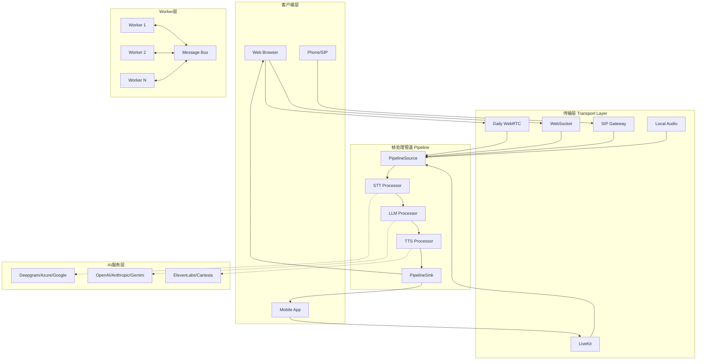

### 4.2 帧处理管道架构 (Frame-Based Pipeline)

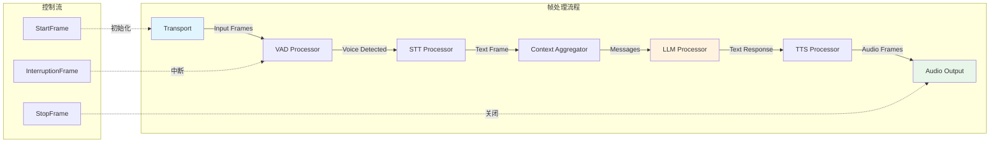

### 4.3 帧类型层次结构

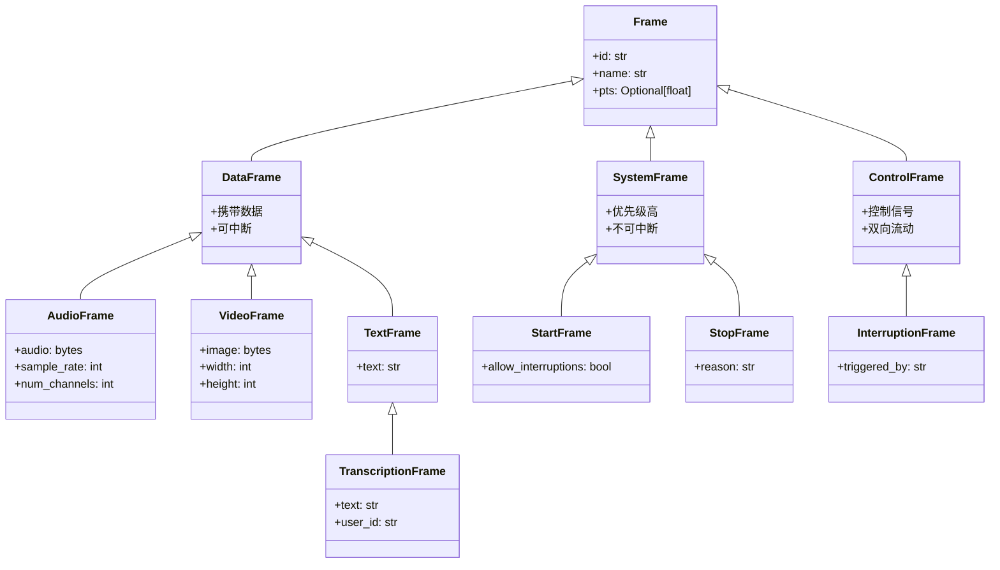

### 4.4 Worker生命周期

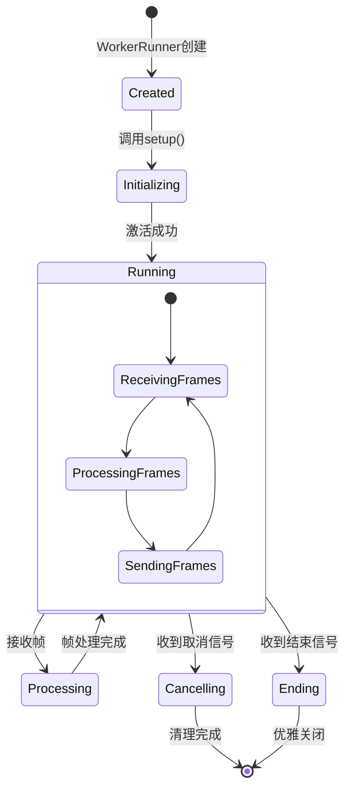

### 4.5 消息总线架构

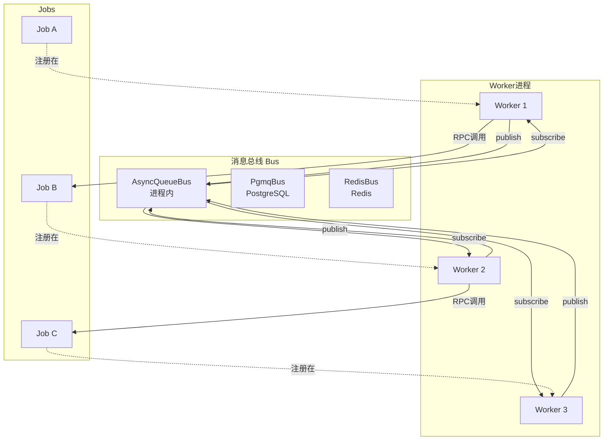

### 4.6 语音对话处理流程

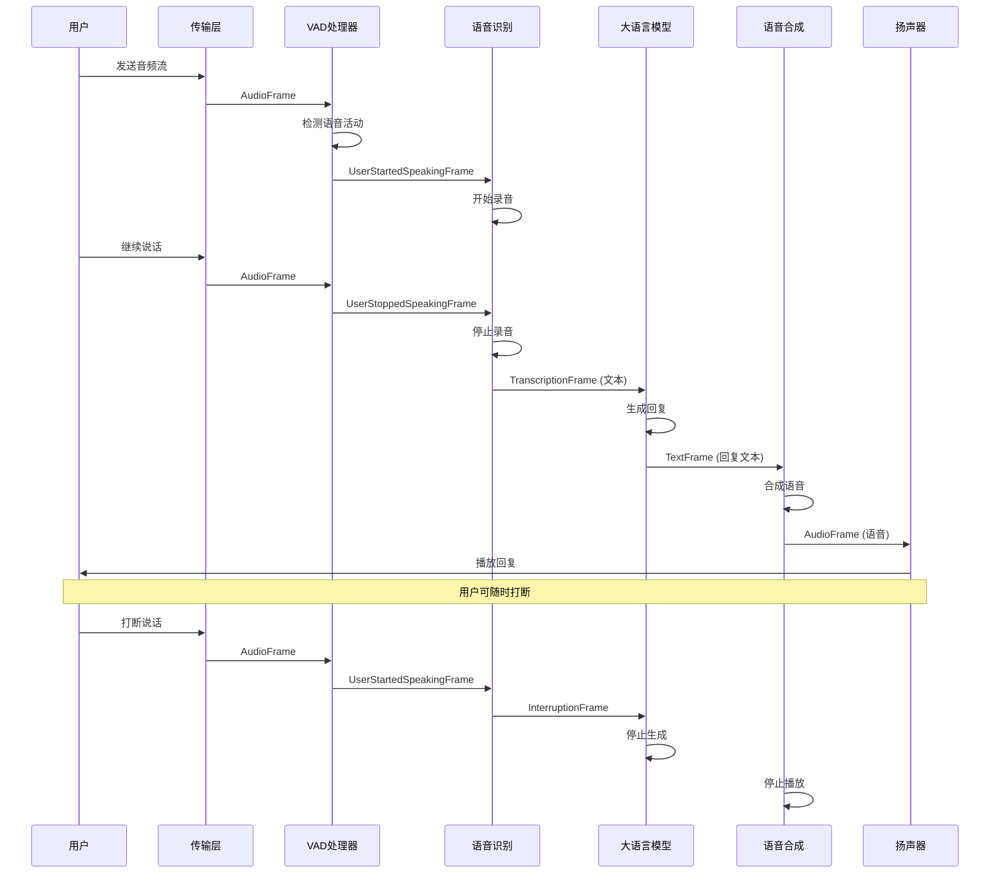

### 4.7 服务集成架构

```mermaid
graph TB
    subgraph "Pipecat核心"
        Processor[帧处理器]
    end

    subgraph "STT服务"
        STT1[Deepgram]
        STT2[AssemblyAI]
        STT3[Azure]
        STT4[Google]
        STT5[Whisper]
    end

    subgraph "LLM服务"
        LLM1[OpenAI]
        LLM2[Anthropic]
        LLM3[Gemini]
        LLM4[Groq]
        LLM5[Ollama]
    end

    subgraph "TTS服务"
        TTS1[ElevenLabs]
        TTS2[Cartesia]
        TTS3[Azure]
        TTS4[OpenAI]
    end

    subgraph "视频服务"
        VID1[HeyGen]
        VID2[Tavus]
        VID3[Simli]
    end

    Processor -->|STTService| STT1
    Processor -->|STTService| STT2
    Processor -->|STTService| STT3
    Processor -->|STTService| STT4
    Processor -->|STTService| STT5

    Processor -->|LLMService| LLM1
    Processor -->|LLMService| LLM2
    Processor -->|LLMService| LLM3
    Processor -->|LLMService| LLM4
    Processor -->|LLMService| LLM5

    Processor -->|TTSService| TTS1
    Processor -->|TTSService| TTS2
    Processor -->|TTSService| TTS3
    Processor -->|TTSService| TTS4

    Processor -->|VisionService| VID1
    Processor -->|VisionService| VID2
    Processor -->|VisionService| VID3
```

### 4.8 管道组合模式

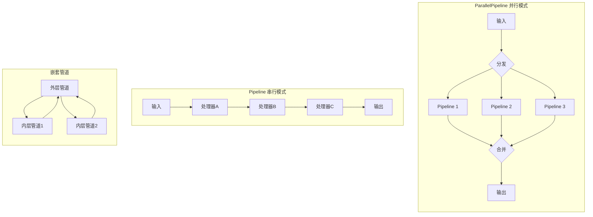

### 4.9 关键概念

#### 关键概念

**1. Frame (帧)** (`frames/frames.py`)

所有数据的传输单位，类型包括：
- 音频帧 (AudioFrame)
- 视频帧 (VideoFrame)  
- 文本帧 (TextFrame)
- 控制帧 (ControlFrame)

> 📊 帧类型层次结构见上方类图

**2. FrameProcessor (帧处理器)**

基础处理单元：
- 接收帧、处理、向下游推送结果
- 支持双向流动：
  - `DOWNSTREAM`: 输入 → 输出
  - `UPSTREAM`: 确认/错误
- 优先级队列：`StartFrame > SystemFrame > 数据/控制帧`

**3. Pipeline (管道)**

线性连接处理器：
- `PipelineSource`: 管道入口
- `PipelineSink`: 管道出口

**4. ParallelPipeline**

并行运行多个管道

### 4.2 Worker模型

**Worker** 是顶层可运行单元：

| Worker类型 | 说明 |
|------------|------|
| `BaseWorker` | 抽象基类，处理激活、结束/取消、总线订阅、作业RPC |
| `PipelineWorker` | 包装用户定义管道的Worker子类 |
| `LLMWorker` | 支持@tool收集的LLM专用Worker |
| `UIWorker` | UI控制专用Worker |

**WorkerRunner**: 执行Worker的高层入口点，管理信号处理和优雅关闭

### 4.3 消息总线 (Bus)

支持多Worker协作的pub/sub消息总线：

| 组件 | 说明 |
|------|------|
| `WorkerBus` | 抽象总线接口 |
| `AsyncQueueBus` | 默认进程内实现 |
| `PgmqBus` | PostgreSQL消息队列 |
| `RedisBus` | Redis消息队列 |

**跨Worker通信**:
- **Jobs**: Worker暴露 `@job` 装饰的处理程序
- **Job Groups**: 并行fan-out到多个Worker

### 4.4 RTVI协议 (Real-Time Voice Interface)

位于 `processors/frameworks/rtvi/`:

| 组件 | 功能 |
|------|------|
| `RTVIProcessor` | 处理客户端消息 (文本输入、音频、DTMF) |
| `RTVIObserver` | 将管道帧转换为传出消息 |

### 4.5 Pipecat Flows

位于 `flows/`，实现结构化对话：
- 预定义和动态对话路径
- 状态管理
- YAML配置支持
- `FlowManager` 管理对话流

### 4.6 音频处理

位于 `audio/`:

| 模块 | 功能 |
|------|------|
| VAD | Voice Activity Detection (Silero VAD分析器) |
| Filters | Krisp, Koala, RNNoise, ai-coustics |
| Mixers | 音频混音 |
| DTMF | 电话按键音 |
| Turn Detection | SmartTurn分析器 |

### 4.10 关键设计模式

#### Context Aggregation (上下文聚合)

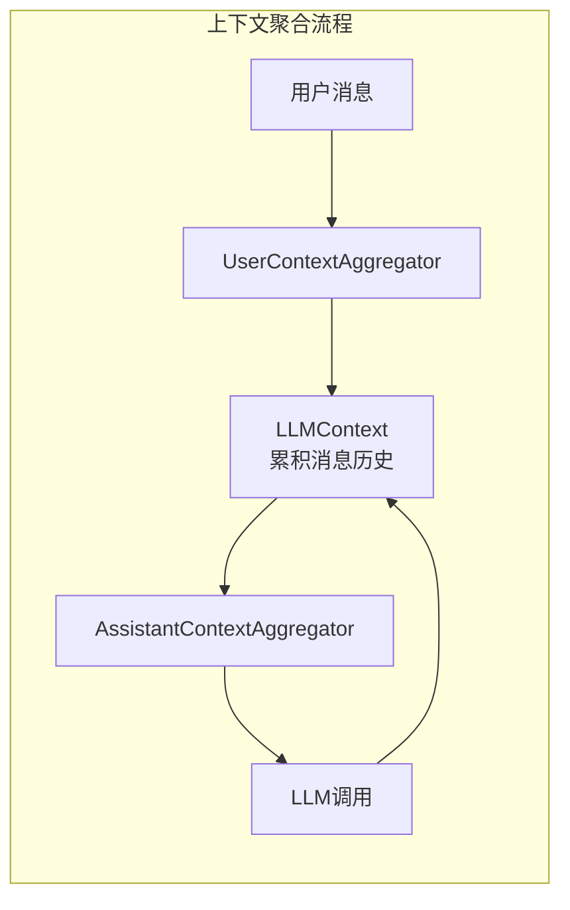

#### Turn Management (轮次管理)

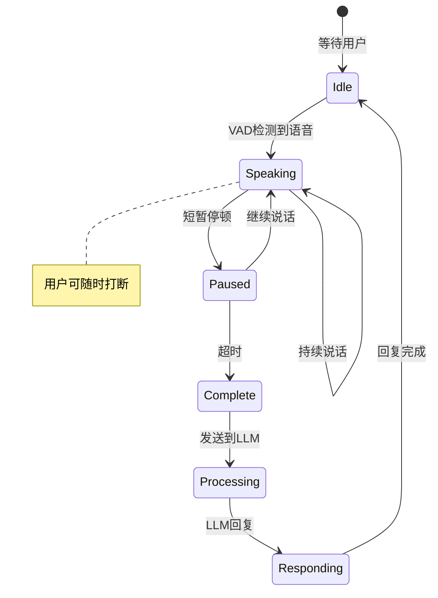

#### Interruption (中断处理)

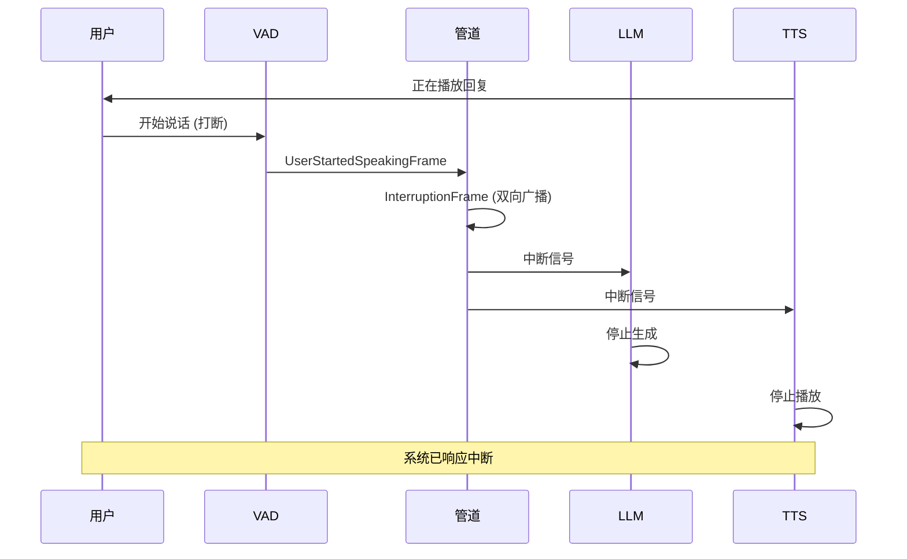

#### 设计模式概览

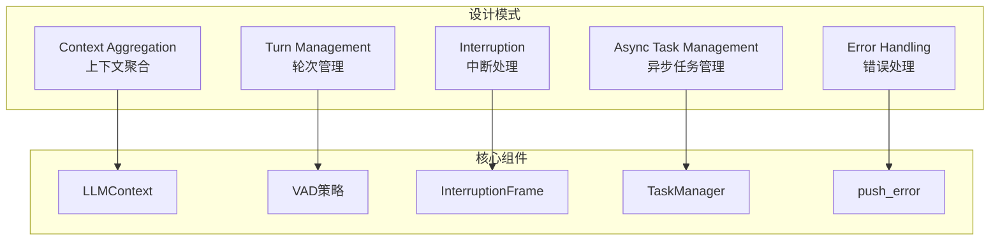

---

## 5. 服务集成

Pipecat支持 **60+** AI服务商集成：

### 5.1 服务分类统计

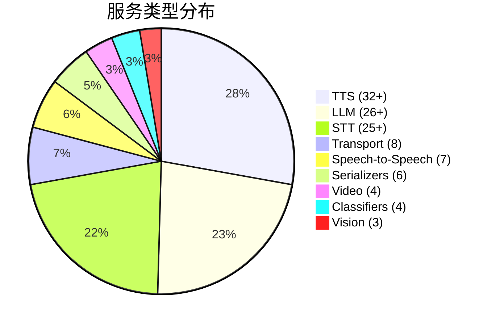

| 类别 | 提供商数量 | 示例 |
|------|----------|------|
| Speech-to-Text (STT) | 25+ | Deepgram, AssemblyAI, Azure, Google, Whisper |
| LLMs | 26+ | OpenAI, Anthropic, Gemini, Groq, Ollama |
| Text-to-Speech (TTS) | 32+ | ElevenLabs, Cartesia, Azure, OpenAI |
| Speech-to-Speech | 7 | OpenAI Realtime, Gemini Live, AWS Nova Sonic |
| Transport | 8 | Daily, LiveKit, WebSocket, Local |
| Serializers | 6 | Twilio, Plivo, Vonage, Telnyx |
| Video | 4 | HeyGen, Tavus, Simli |
| Classifiers | 4 | Cloudflare, Hume, OpenAI |
| Vision & Image | 3 | fal, Google, Moondream |

### 5.2 STT服务

支持25+语音识别服务：

| 服务 | 文件 |
|------|------|
| AssemblyAI | `services/assemblyai/` |
| Azure | `services/azure/` |
| Deepgram | `services/deepgram/` |
| Google | `services/google/` |
| Whisper | `services/whisper/` |
| ... | 更多 |

### 5.3 LLM服务

支持26+大语言模型：

| 服务 | 说明 |
|------|------|
| OpenAI | GPT-4, GPT-3.5 |
| Anthropic | Claude系列 |
| Google Gemini | Gemini Pro/Ultra |
| Groq | 高速推理 |
| Ollama | 本地模型 |
| Together | 开源模型 |
| ... | 更多 |

### 5.4 TTS服务

支持32+语音合成服务：

| 服务 | 特点 |
|------|------|
| ElevenLabs | 高质量语音 |
| Cartesia | 实时语音 |
| Azure | 多语言 |
| OpenAI | 自然语音 |
| Google | WaveNet |
| ... | 更多 |

### 5.5 服务基类

| 基类 | 文件 | 说明 |
|------|------|------|
| `AIService` | `ai.py` | 基础AI服务 |
| `LLMService` | `llm_service.py` (122KB) | LLM服务 |
| `STTService` | `stt_service.py` | 语音识别服务 |
| `TTSService` | `tts_service.py` (127KB) | 语音合成服务 |
| `VisionService` | `vision_service.py` | 视觉服务 |

---

## 6. 传输层

### 6.1 传输层架构

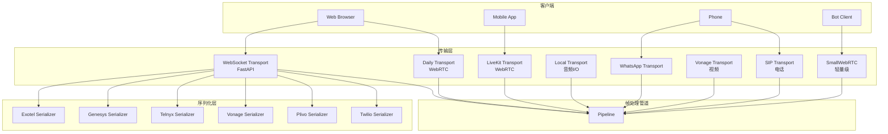

### 6.2 支持的传输类型

| 传输类型 | 目录 | 说明 |
|----------|------|------|
| Daily | `transports/daily/` | WebRTC (Daily.co) |
| LiveKit | `transports/livekit/` | WebRTC (LiveKit) |
| WebSocket | `transports/websocket/` | FastAPI WebSocket |
| Local | `transports/local/` | 本地音频 |
| SmallWebRTC | `transports/smallwebrtc/` | 轻量WebRTC |
| Vonage | `transports/vonage/` | Vonage视频 |
| SIP | `transports/sip/` | SIP电话 |
| WhatsApp | `transports/whatsapp/` | WhatsApp |

### 6.2 序列化器

用于WebSocket传输的帧序列化：

| 序列化器 | 说明 |
|----------|------|
| Twilio | Twilio协议 |
| Genesys | Genesys协议 |
| Plivo | Plivo协议 |
| Vonage | Vonage协议 |
| Telnyx | Telnyx协议 |
| Exotel | Exotel协议 |

处理电话协议和音频编码（如μ-law）

---

## 7. 示例代码

### 7.1 示例学习路径

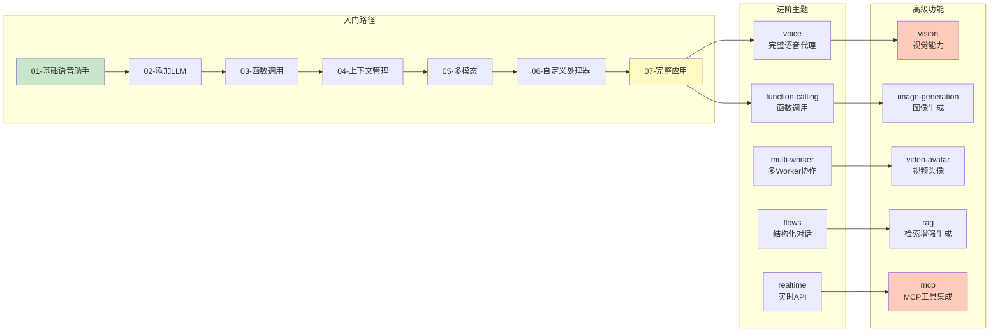

### 7.2 示例目录结构

`examples/` 包含26个示例目录，涵盖各种使用场景：

| 目录 | 功能 |
|------|------|
| `getting-started/` | 入门教程 (01-07递进式示例) |
| `voice/` | 完整STT+LLM+TTS语音代理 |
| `function-calling/` | 函数调用示例 |
| `transcription/` | 语音转文字 |
| `vision/` | 图像描述和视觉能力 |
| `image-generation/` | 图像生成 |
| `realtime/` | 实时API (OpenAI Realtime、Gemini Live等) |
| `multi-worker/` | 多Worker协作 |
| `flows/` | 结构化对话 (YAML定义) |
| `mcp/` | MCP工具服务器集成 |
| `transports/` | 传输层示例 |
| `video-avatar/` | 视频头像 (Tavus、HeyGen等) |
| `expressive-conversation/` | 表情对话 |
| `turn-management/` | 轮次管理 |
| `observability/` | 可观察性 |
| `rag/` | 检索增强生成 |

### 7.2 入门示例

`getting-started/` 包含7个递进式示例：

| 示例 | 内容 |
|------|------|
| 01 | 基础语音助手 |
| 02 | 添加LLM |
| 03 | 函数调用 |
| 04 | 上下文管理 |
| 05 | 多模态 |
| 06 | 自定义处理器 |
| 07 | 完整应用 |

---

## 8. 开发配置

### 8.1 开发工作流程

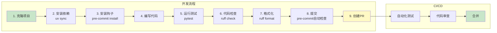

### 8.2 开发环境设置

```bash
# 克隆项目
git clone https://github.com/pipecat-ai/pipecat.git
cd pipecat

# 安装开发依赖
uv sync --group dev --all-extras --no-extra gstreamer --no-extra local

# 安装pre-commit钩子
uv run pre-commit install

# 运行测试
uv run pytest

# 代码检查
uv run ruff check
uv run ruff format --check
```

### 8.2 测试配置

```toml
[tool.pytest.ini_options]
addopts = "--verbose -n auto"  # 并行运行
testpaths = ["tests"]
pythonpath = ["src"]
asyncio_default_fixture_loop_scope = "function"
```

### 8.3 代码质量配置

```toml
[tool.ruff]
line-length = 100

[tool.ruff.lint]
select = ["ASYNC", "B", "D", "F", "I", "RUF006", "UP"]
```

### 8.4 变更日志管理

使用 `towncrier` 管理变更日志：
- 片段目录: `changelog/`
- 类型: added, changed, deprecated, removed, fixed, performance, security, other

---

## 9. 生态系统

### 9.1 生态系统全景

```mermaid
graph TB
    subgraph "Pipecat核心框架"
        Core[pipecat-ai<br/>Python框架]
    end

    subgraph "客户端SDK"
        JS[JavaScript]
        React[React]
        RN[React Native]
        Swift[Swift iOS]
        Kotlin[Kotlin Android]
        CPP[C++]
        ESP[ESP32]
    end

    subgraph "开发工具"
        CLI[pipecat CLI<br/>项目脚手架]
        Flows[Pipecat Flows<br/>结构化对话]
        UI[Pipecat UI<br/>shadcn组件库]
    end

    subgraph "调试工具"
        Whisker[Whisker<br/>实时调试器]
        Tail[Tail<br/>终端仪表板]
    end

    subgraph "部署选项"
        Local[本地运行]
        Cloud[Pipecat Cloud<br/>云端部署]
    end

    subgraph "集成服务"
        STT_S[25+ STT服务]
        LLM_S[26+ LLM服务]
        TTS_S[32+ TTS服务]
        Transp_S[8种传输]
    end

    Core --> JS
    Core --> React
    Core --> RN
    Core --> Swift
    Core --> Kotlin
    Core --> CPP
    Core --> ESP

    Core --> CLI
    Core --> Flows
    Core --> UI

    Core --> Whisker
    Core --> Tail

    Core --> Local
    Core --> Cloud

    Core --> STT_S
    Core --> LLM_S
    Core --> TTS_S
    Core --> Transp_S

    style Core fill:#e3f2fd
    style Cloud fill:#fff3e0
```

### 9.2 客户端SDK

支持多平台客户端：

| 平台 | 状态 |
|------|------|
| JavaScript | ✅ |
| React | ✅ |
| React Native | ✅ |
| Swift (iOS) | ✅ |
| Kotlin (Android) | ✅ |
| C++ | ✅ |
| ESP32 | ✅ |

### 9.2 相关工具

| 工具 | 说明 |
|------|------|
| **Pipecat UI** | shadcn组件库 |
| **Pipecat Flows** | 结构化对话 |
| **Whisker** | 实时调试器 |
| **Tail** | 终端仪表板 |

### 9.3 部署选项

| 方式 | 说明 |
|------|------|
| 本地运行 | 开发/测试 |
| Pipecat Cloud | 云端部署 |

---

## 10. 总结

### 10.1 项目特点

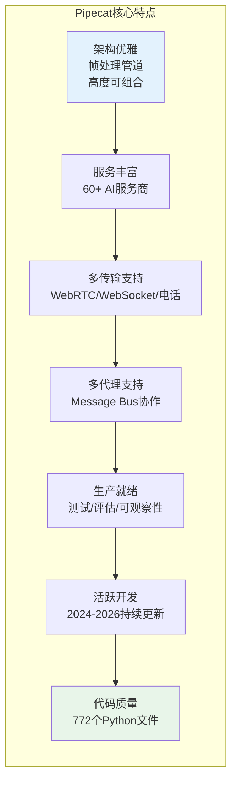

### 10.2 适用场景

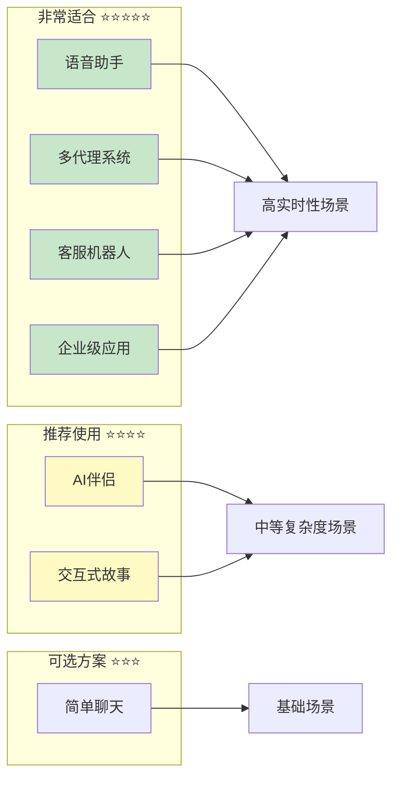

### 10.3 项目特点总结

1. **架构优雅**: 帧处理管道模式，高度可组合
2. **服务丰富**: 60+ AI服务商集成
3. **多传输支持**: WebRTC、WebSocket、电话等
4. **多代理支持**: 通过Bus实现Worker间协作
5. **生产就绪**: 完善的测试、评估、可观察性支持
6. **活跃开发**: 2024-2026年持续更新
7. **代码质量**: 772个Python文件，良好的类型注解和文档

### 适用场景

| 场景 | 推荐度 |
|------|--------|
| 语音助手 | ⭐⭐⭐⭐⭐ |
| 多代理系统 | ⭐⭐⭐⭐⭐ |
| 客服机器人 | ⭐⭐⭐⭐⭐ |
| AI伴侣 | ⭐⭐⭐⭐ |
| 交互式故事 | ⭐⭐⭐⭐ |
| 企业级应用 | ⭐⭐⭐⭐⭐ |

### 技术亮点

- **实时处理**: 基于帧的管道架构，支持流式处理
- **中断机制**: 支持用户随时打断AI响应
- **上下文管理**: 自动维护对话上下文
- **错误恢复**: 优雅的错误处理和恢复机制
- **可扩展性**: 插件化的服务架构

### 学习资源

- 官方文档: https://docs.pipecat.ai
- 示例代码: `examples/` 目录
- API参考: `docs/api/` 目录
- 架构文档: `docs/architecture/` 目录

---

*本文档由 Claude Opus 5 自动生成*
