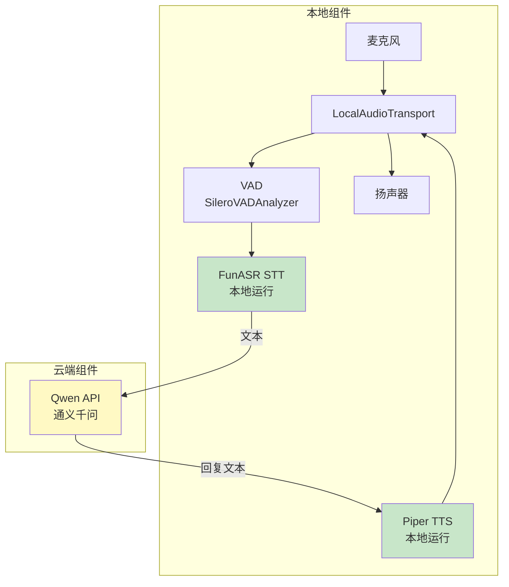
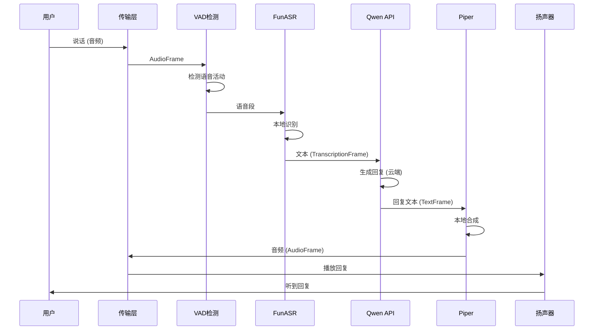

# FunASR + Qwen + Piper 本地语音助手部署方案

> 创建日期: 2026-11-15  
> 方案: 本地STT + 云端LLM + 本地TTS

---

## 目录

- [1. 方案概述](#1-方案概述)
- [2. 架构设计](#2-架构设计)
- [3. 环境准备](#3-环境准备)
- [4. 安装步骤](#4-安装步骤)
- [5. 配置说明](#5-配置说明)
- [6. 运行指南](#6-运行指南)
- [7. 故障排查](#7-故障排查)

---

## 1. 方案概述

### 组件选择

| 组件 | 选择 | 说明 | 成本 |
|------|------|------|------|
| **STT** | FunASR (本地) | 阿里开源，中文识别准确率高 | 免费 |
| **LLM** | Qwen API (云端) | 通义千问，中文理解能力强 | 按量计费 |
| **TTS** | Piper (本地) | 开源TTS，支持多语言 | 免费 |
| **传输** | LocalAudio | 本地麦克风/扬声器 | 免费 |

### 优势

- ✅ **成本低**: 只需支付 LLM API 费用
- ✅ **延迟低**: STT/TTS 本地运行，无网络延迟
- ✅ **中文优化**: FunASR + Qwen 对中文支持优秀
- ✅ **隐私保护**: 语音数据本地处理

### 硬件要求

| 资源 | 最低要求 | 推荐配置 |
|------|----------|----------|
| CPU | 4核 | 8核+ |
| 内存 | 4GB | 8GB+ |
| 硬盘 | 2GB (模型) | 5GB+ |
| GPU | 可选 | 推荐 (加速FunASR) |
| 网络 | 需要 (Qwen API) | 稳定连接 |

---

## 2. 架构设计

### 2.1 系统架构图



### 2.2 数据流



### 2.3 管道结构

```
Pipeline [
    Transport.input()      # 音频输入
    → VAD (Silero)         # 语音活动检测
    → STT (FunASR)         # 语音转文本
    → UserAggregator       # 用户消息聚合
    → LLM (Qwen)           # 大语言模型
    → TTS (Piper)          # 文本转语音
    → Transport.output()   # 音频输出
    → AssistantAggregator  # 助手消息聚合
]
```

---

## 3. 环境准备

### 3.1 系统要求

- **操作系统**: Linux (Ubuntu 20.04+), macOS, Windows
- **Python**: 3.11 - 3.14
- **网络**: 需要访问 Qwen API

### 3.2 获取 Qwen API Key

1. 访问 [阿里云百炼平台](https://bailian.console.aliyun.com/)
2. 登录并开通模型服务
3. 在「API Key 管理」创建新的 API Key
4. 复制保存 API Key

### 3.3 检查音频设备

```bash
# Linux - 检查音频设备
arecord -l  # 录音设备
aplay -l    # 播放设备

# macOS - 检查音频设备
system_profiler SPAudioDataType

# Python 测试
python -c "import sounddevice; print(sounddevice.query_devices())"
```

---

## 4. 安装步骤

### 4.1 创建虚拟环境

```bash
# 进入项目目录
cd /home/wangwei/wei/workspacePy/sound/pipecat-main

# 使用 uv 创建虚拟环境
uv venv .venv-funasr
source .venv-funasr/bin/activate

# 或者使用 Python venv
python -m venv .venv-funasr
source .venv-funasr/bin/activate
```

### 4.2 安装依赖

```bash
# 安装 pipecat (基础)
pip install pipecat-ai

# 安装 FunASR (本地STT)
pip install "pipecat-ai[funasr]"

# 安装 Piper (本地TTS)
pip install "pipecat-ai[piper]"

# 安装 Qwen (云端LLM，使用OpenAI兼容接口)
# Qwen 服务已包含在 pipecat-ai 中

# 其他依赖
pip install python-dotenv loguru
```

### 4.3 一键安装脚本

```bash
#!/bin/bash
# install.sh

set -e

echo "=== Pipecat 语音助手安装脚本 ==="

# 创建虚拟环境
echo "1. 创建虚拟环境..."
python -m venv .venv-funasr
source .venv-funasr/bin/activate

# 升级 pip
echo "2. 升级 pip..."
pip install --upgrade pip

# 安装依赖
echo "3. 安装 pipecat-ai..."
pip install pipecat-ai

echo "4. 安装 FunASR (本地STT)..."
pip install "pipecat-ai[funasr]"

echo "5. 安装 Piper (本地TTS)..."
pip install "pipecat-ai[piper]"

echo "6. 安装其他依赖..."
pip install python-dotenv loguru

echo "=== 安装完成 ==="
echo "激活虚拟环境: source .venv-funasr/bin/activate"
```

---

## 5. 配置说明

### 5.1 环境变量

创建 `.env` 文件：

```bash
# .env 文件

# Qwen API Key (必填)
QWEN_API_KEY=sk-your-api-key-here

# 可选配置
# QWEN_MODEL=qwen-plus          # 默认模型
# QWEN_BASE_URL=https://dashscope-intl.aliyuncs.com/compatible-mode/v1

# FunASR 配置
# FUNASR_MODEL=iic/SenseVoiceSmall  # STT模型
# FUNASR_LANGUAGE=zh                # 语言: zh, en, ja, ko, auto

# Piper 配置
# PIPER_VOICE=zh_CN-huayan-medium   # 中文语音
# PIPER_LENGTH_SCALE=1.0            # 语速: <1更快, >1更慢
```

### 5.2 配置项说明

#### Qwen 配置

| 配置项 | 默认值 | 说明 |
|--------|--------|------|
| `QWEN_API_KEY` | - | 必填，阿里云API Key |
| `QWEN_MODEL` | `qwen-plus` | 模型选择 |
| `QWEN_BASE_URL` | `https://dashscope-intl.aliyuncs.com/compatible-mode/v1` | API地址 |

**可用模型**:
- `qwen-turbo`: 快速，成本低
- `qwen-plus`: 平衡，推荐
- `qwen-max`: 最强，成本高

#### FunASR 配置

| 配置项 | 默认值 | 说明 |
|--------|--------|------|
| `model` | `iic/SenseVoiceSmall` | 模型名称 |
| `language` | `auto` | 语言: zh, en, ja, ko, auto |

**可用模型**:
- `iic/SenseVoiceSmall`: 小型，快速
- `iic/SenseVoiceLarge`: 大型，准确

#### Piper 配置

| 配置项 | 默认值 | 说明 |
|--------|--------|------|
| `voice` | `en_US-ryan-high` | 语音名称 |
| `length_scale` | `1.0` | 语速，<1更快 |
| `noise_scale` | `0.667` | 随机性 |

**中文语音**:
- `zh_CN-huayan-medium`: 女声，中等质量
- `zh_CN-huayan-x_low`: 女声，低质量，快速

---

## 6. 运行指南

### 6.1 基础运行

```bash
# 激活虚拟环境
source .venv-funasr/bin/activate

# 设置环境变量
export QWEN_API_KEY="sk-your-api-key-here"

# 运行语音助手
python voice_assistant.py
```

### 6.2 运行示例

```bash
# 使用提供的示例
cd /home/wangwei/wei/workspacePy/sound/sound-ext/pipecat/deploy

# 运行基础版
python voice_assistant.py

# 运行带日志版
python voice_assistant_verbose.py
```

### 6.3 交互说明

1. 启动后，助手会先说「你好，有什么可以帮你的？」
2. 等待你说话（VAD自动检测）
3. 说完后等待识别和处理
4. 听到回复后继续对话
5. 按 `Ctrl+C` 退出

---

## 7. 故障排查

### 7.1 常见问题

#### 问题1: FunASR 下载慢

```bash
# 设置 HuggingFace 镜像
export HF_ENDPOINT=https://hf-mirror.com
```

#### 问题2: Piper 语音下载失败

```bash
# 手动下载语音模型
mkdir -p ~/.cache/pipecat/piper
cd ~/.cache/pipecat/piper

# 下载中文语音
wget https://huggingface.co/rhasspy/piper-voices/resolve/main/zh/zh_CN/huayan/medium/zh_CN-huayan-medium.onnx
wget https://huggingface.co/rhasspy/piper-voices/resolve/main/zh/zh_CN/huayan/medium/zh_CN-huayan-medium.onnx.json
```

#### 问题3: 音频设备错误

```bash
# 检查音频设备
python -c "import sounddevice; print(sounddevice.query_devices())"

# 指定设备 (在代码中)
transport = LocalAudioTransport(
    LocalAudioTransportParams(
        audio_in_device=0,  # 输入设备ID
        audio_out_device=0, # 输出设备ID
    )
)
```

#### 问题4: Qwen API 错误

```bash
# 检查 API Key
curl -X POST https://dashscope-intl.aliyuncs.com/compatible-mode/v1/chat/completions \
  -H "Authorization: Bearer $QWEN_API_KEY" \
  -H "Content-Type: application/json" \
  -d '{"model": "qwen-plus", "messages": [{"role": "user", "content": "你好"}]}'
```

### 7.2 日志级别

```python
# 调整日志级别
import logging
logging.basicConfig(level=logging.DEBUG)  # DEBUG, INFO, WARNING, ERROR
```

---

## 附录

### A. 完整代码清单

见以下文件：
- `voice_assistant.py` - 基础版
- `voice_assistant_verbose.py` - 详细日志版

### B. 相关链接

- [Pipecat 文档](https://docs.pipecat.ai)
- [FunASR GitHub](https://github.com/modelscope/FunASR)
- [Piper TTS](https://github.com/rhasspy/piper)
- [Qwen API 文档](https://help.aliyun.com/zh/dashscope/developer-reference/api-details)

### C. 成本估算

| 组件 | 成本 |
|------|------|
| FunASR | 免费 (本地) |
| Piper | 免费 (本地) |
| Qwen | 约 0.02元/千tokens |

**示例**: 每分钟对话约 1000 tokens，成本约 0.02元

---

*本文档由 Claude Opus 5 自动生成*
